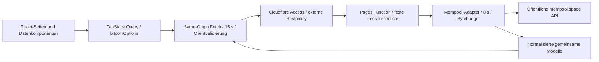
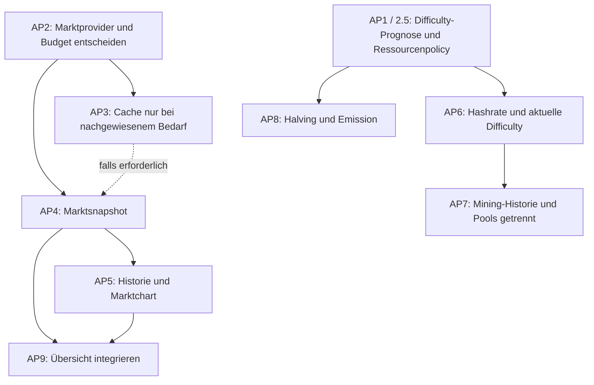

# Phase 2.4 – Funktions- und Dateninventur mit Architekturplanung

Stand: **30. Oktober 2026**, Zeitzone Europe/Berlin. Repository:
`CFPlusPlus/bitcoin-dashboard`.

**Analyse und Planung. Dieses Dokument erteilt keinen Implementierungsauftrag.**
Anwendung, API-Verträge, Abhängigkeiten, Cloudflare-Konfiguration, Access und
Secrets werden in dieser Phase nicht verändert. Alle nachfolgend vorgeschlagenen
Endpunkte, Modelle, Intervalle und Arbeitspakete sind noch nicht implementiert.

## 1. Executive Summary

Das vorhandene Fundament kann schrittweise erweitert werden. Same-Origin-API,
getrennte Provider-Normalisierung, gemeinsame TypeScript-Modelle, Laufzeitvalidierung
auf beiden Seiten, begrenzte Upstream-Antworten und deterministische Tests sind
bereits vorhanden. Eine neue Datenplattform oder ein vollständiger Umbau ist
dafür nicht erforderlich.

Die fachliche Reife unterscheidet sich deutlich:

- **Übersicht:** echte Blockhöhe, Gebühren, Mempool und jüngste Blöcke; vier
  unverbundene KPIs, Halving-Platzhalter und synthetischer Kurschart.
- **Markt:** sechs unverbundene KPIs, derselbe synthetische Chart und ein
  Sats-Rechner-Platzhalter. Keine echten Marktpreise, Historie oder Zeitraumwahl.
- **Blockchain:** echte Daten einschließlich interaktivem Gebührenhistogramm,
  fünf Gebührenempfehlungen, Blockauswahl, Details und Gewichtsauslastung.
  Durchschnittliche Blockzeit und Durchsatz fehlen weiterhin.
- **Netzwerk & Mining:** sechs unverbundene KPIs und vier Platzhalterflächen;
  keine produktive Mining-Datenabfrage.

Wichtigste Konsequenzen:

1. **Bestehendes erhalten:** Blockchain ist die funktionale und gestalterische
   Referenz. Die anderen Seiten brauchen eigene Informationshierarchien.
2. **Einen Provider je Schritt:** Mining kann zunächst beim vorhandenen Provider
   bleiben. Ein zusätzlicher Marktprovider braucht eine ausdrückliche Auswahl
   mit Nutzungsbedingungen, Abrufbudget und getesteter Betriebsstrategie.
3. **Browsercache ist kein gemeinsamer Cache:** Jede Browserinstanz verursacht
   eigene Providerabrufe. Derzeit gibt es serverseitig keinen Cache und kein
   globales Abrufbudget. Diese Grenze wird bei begrenzten Markttarifen relevant.
4. **Cache API nicht voraussetzen:** Cloudflare dokumentiert eine Einschränkung
   hinter Access. Ein Cache-Konzept muss die tatsächliche Pages-/Access-Topologie
   prüfen; ein einfaches `caches.default` ist hier keine belegte Lösung.
   [Cloudflare Cache API](https://developers.cloudflare.com/workers/runtime-apis/cache/).
5. **Nächste Implementierungsphase:** eine begrenzte Difficulty-Anpassungsressource
   und ein erster echter Mining-Abschnitt, mit ressourcenspezifischer Datenfrische.
   Ein Provider, ein Endpunkt, eine Fachseite, keine neue Persistenz oder Secrets.

Der aktuelle Stand besteht erneut **238 Unit-/Komponententests und 55
Chromium-E2E-Tests**. Das belegt lokale Verträge und Verhalten mit Fixtures,
keine verifizierte produktive Datenlieferung. Für keinen Fachwert liegt in dieser
Phase ein authentifizierter Produktionsnachweis mit deploytem SHA vor.

### 1.1 Untersuchungsbasis und Evidenz

- Ausgangsstand: `68bfdece622546eddc127648abaab0ed9524df51`, Phase-2.3-Branch.
- Nach Abruf von `origin/main`: geprüfte Basis
  [`86b7b35fbe84037df8339aedce0d07e9eb2c41bd`](https://github.com/CFPlusPlus/bitcoin-dashboard/commit/86b7b35fbe84037df8339aedce0d07e9eb2c41bd),
  Merge von [PR #16](https://github.com/CFPlusPlus/bitcoin-dashboard/pull/16).
  Der Merge enthält denselben Anwendungsstand.
- Analysebranch: `feature/phase-2.4-data-function-inventory`.
- Untersucht wurden alle vier Route-Komponenten, ihre Daten-/Diagrammkomponenten,
  `src/lib`, `shared`, alle Functions, die 13 Testdateien, vier E2E-Spezifikationen
  mit Fixture-Helfer, Build-/CI-/Routing-Konfiguration und die bisherige
  Phasendokumentation. Quellcode und ausgeführte Tests haben Vorrang vor alten
  Beschreibungen. `design/prototypes` ist eine isolierte Designreferenz.
- Externe Recherche: offizielle Provider- und Cloudflare-Dokumentation am
  Berichtstag. Sie ist veränderlich. Es wurden keine Providerkonten angelegt,
  Schlüssel benutzt oder neue Datenquellen integriert.

| Evidenz | Bedeutung                                         | Grenze                                                      |
| ------- | ------------------------------------------------- | ----------------------------------------------------------- |
| C       | Direkt im aktuellen Code vorhanden                | Noch kein Nachweis des deployten Verhaltens                 |
| T       | Vorhandener automatischer Test erneut erfolgreich | Fixtures/Mocks, soweit nicht ausdrücklich lokaler HTTP-Test |
| D       | In offizieller externer Dokumentation belegt      | Kein Laufzeit-, Tarifkonto- oder Verfügbarkeitsnachweis     |
| B       | Frühere, dokumentierte Betreiberbeobachtung       | Nur deren damaliger Host-/Pfadumfang                        |
| V       | Am konkreten produktiven Deployment verifiziert   | In dieser Phase für Fachfunktionen nicht vorhanden          |
| E       | Empfehlung oder Annahme                           | Noch zu entscheiden und anschließend zu testen              |

Die Datenmatrix verwendet **Echt** für den produktiven Datenpfad zu öffentlichen
Bitcoin-Daten, nicht als Behauptung eines hier geprüften Live-Betriebs.
**Demo** bezeichnet synthetische Laufzeitdaten, **Platzhalter** eine Oberfläche
ohne Datenverarbeitung. Testfixtures werden gesondert behandelt.

## 2. Vollständige Funktionsinventur und Datenmatrix

### 2.1 Leseschlüssel

Die folgenden Tabellen bilden gemeinsam die Datenmatrix. Jede Zeile nennt
Fachseite, Funktion, benötigte Daten, vorhandenen API-Endpunkt, externe Quelle,
Implementierungs-/Validierungsstatus, Intervall, Cache, Tests, Einschränkung und
Priorität. Die Codes vermeiden widersprüchliche Wiederholungen derselben Policy.

**Vorhandene Endpunkte:** H = `/api/bitcoin/height`, B = `/api/bitcoin/blocks`,
F = `/api/bitcoin/fees`, M = `/api/bitcoin/mempool`, L =
`/api/bitcoin/latest-block`. Die vollständige Providerzuordnung steht in §3.2.
`—` bedeutet: kein entsprechender Dashboard-Endpunkt vorhanden.

**Validierung:** V2 = Upstream normalisiert/validiert und normalisierte Antwort
im Browser validiert; V2+A = zusätzlich getestete fachliche Ableitung; — = kein
Datenvertrag. Keine dieser Prüfungen beweist unabhängige onchain Korrektheit.

**Aktualisierung/Cache im Ist:** Q60 = aktiver sichtbarer Query alle 60 s,
`staleTime` 60 s, Fokus-/Reconnect-Refetch für stale Daten; Q60 konfiguriert =
dieselbe Policy verfügbar, aber kein aktiver UI-Verbraucher; DQ = Demo-Query ohne
Intervall, 60 s `staleTime` aus globaler Vorgabe; — = kein Abruf.
CQ = Query-Speicher je Browserinstanz, inaktive Echt-Daten nach 10 min entfernt,
HTTP/Upstream `no-store`, kein Servercache. CD = Demo im Query-Speicher,
Standard-GC von TanStack Query, keine Bitcoin-API. — = kein Datencache.

**Testgruppen:**

| Code | Tatsächlich vorhandene Nachweise                                                                                                                                                      |
| ---- | ------------------------------------------------------------------------------------------------------------------------------------------------------------------------------------- |
| T1   | `mempool.test.ts`, `bitcoin-validation.test.ts`, `bitcoin-numeric-contract.test.ts`: Normalisierung, gemeinsame Zahlenbereiche, fehlerhafte Envelopes/Payloads, Null-/Nullwertgrenzen |
| T2   | `functions.test.ts`, `upstream-robustness.test.ts`, `bitcoin-retry.test.ts`: Routen, Methoden, sichere Fehler, Limits, Streams, Timeouts, Abbruch, Retry                              |
| T3   | `bitcoin-ui.test.tsx`: Übersichtswerte, Quelle, Abrufzeit, Erstladen, Fehler, Stale-Erhaltung, Retry, geteilte Queries, Hintergrundpause                                              |
| T4   | `blockchain-analysis.test.ts`, `blockchain-reference.test.tsx`: Histogramm, Summen, Skalierung, Ressourcenfrische, Blockauswahl, Interaktionen und unabhängige Fehler                 |
| T5   | `app.test.tsx`, Chart-/Boundary-Tests: Shell, Platzhalter-/Demo-Kennzeichnung, Theme, Chart-Lebenszyklus, Render-/Importfehler                                                        |
| E1   | `e2e/dashboard.spec.ts`, `e2e/shell.spec.ts`: vier Routen, Theme, Reflow, Fokus, API-Fehler mit Browserfixtures                                                                       |
| E2   | `e2e/blockchain.spec.ts`: BC-23-Testfixture, Histogramm-/Blockbedienung, Refresh, Stale, Touch, Theme-/Viewportmatrix                                                                 |
| E3   | `e2e/pages.spec.ts`: echte lokale Wrangler-HTTP-Antworten für Health, 404, 405, SPA/Assets; keine erfolgreichen Provider-GETs                                                         |

**Prioritäten:** P0 = Voraussetzung vor dem davon betroffenen Ausbau, kein
behaupteter Produktionsnotfall; P1 = nächster fachlicher Kern; P2 = anschließender
Ausbau; P3 = optional/später. Bei bereits implementierten Funktionen meint die
Priorität deren weitere Bearbeitung, nicht das Abschalten ihres Betriebs.

**Produktionsstatus für jede Zeile:** V offen. Implementierung und T-Nachweise
werden unabhängig davon ausgewiesen.

### 2.2 Übersicht

Code: [overview.tsx](../src/pages/overview.tsx),
[bitcoin-data.tsx](../src/components/bitcoin-data.tsx),
[dashboard.tsx](../src/components/dashboard.tsx).

| Fachseite | Funktion                        | Benötigte Daten                                        | API Ist                      | Externe Quelle Ist / Kandidat | Status              | Validierung       | Intervall Ist | Cache Ist | Tests                  | Einschränkung                                           | Prio |
| --------- | ------------------------------- | ------------------------------------------------------ | ---------------------------- | ----------------------------- | ------------------- | ----------------- | ------------- | --------- | ---------------------- | ------------------------------------------------------- | ---- |
| Übersicht | Bitcoin-Kurs, USD               | Aggregierter BTC/USD-Preis, Quellzeit                  | —                            | Keine / Marktprovider §5      | Platzhalter         | —                 | —             | —         | T5, E1 nur Darstellung | Keine Kursberechnung                                    | P1   |
| Übersicht | Marktkapitalisierung            | Preis und definierte Umlaufmenge bzw. Providerwert     | —                            | Keine / Marktprovider         | Platzhalter         | —                 | —             | —         | T5, E1 nur Darstellung | Nicht aus vorhandener Höhe berechnet                    | P1   |
| Übersicht | Handelsvolumen 24 h, USD        | Aggregiertes rollierendes Spotvolumen                  | —                            | Keine / Marktprovider         | Platzhalter         | —                 | —             | —         | T5, E1 nur Darstellung | Kein Transaktions- oder Börsenvolumen vorhanden         | P1   |
| Übersicht | Blockhöhe                       | `height`                                               | H                            | mempool.space                 | Echt, implementiert | V2                | Q60           | CQ        | T1–T3, E1              | Unabhängig von B abgerufen                              | P2   |
| Übersicht | Hashrate, EH/s                  | Schätzung mit definiertem Fenster                      | —                            | Keine / Mempool-Mining        | Platzhalter         | —                 | —             | —         | T5, E1 nur Darstellung | Auch serverseitig nicht angebunden                      | P2   |
| Übersicht | Gebühren, hohe Priorität        | `fastest`, sat/vB                                      | F                            | mempool.space                 | Echt, implementiert | V2                | Q60           | CQ        | T1–T3, E1              | Nur eine von fünf Empfehlungen sichtbar                 | P2   |
| Übersicht | Mempool-TX, MvB, Gesamtgebühren | `transactionCount`, `virtualSizeBytes`, `totalFeeSats` | M                            | mempool.space                 | Echt, implementiert | V2                | Q60           | CQ        | T1–T3, E1              | Histogramm mitgeliefert, hier nicht visualisiert        | P2   |
| Übersicht | BTC-Kursverlauf                 | Für echte Funktion: Preiszeitreihe                     | —                            | Keine; lokales `demoSeries`   | Demo, implementiert | Kein Marktvertrag | DQ            | CD        | T5, E1                 | 12 Indexwerte, keine Kurse oder historischen Zeitpunkte | P1   |
| Übersicht | Halving-Fortschritt             | Höhe, festgelegte Protokollmethodik                    | —; H nur als möglicher Input | Noch keine Ableitung          | Platzhalter         | —                 | —             | —         | T5, E1 nur Darstellung | Keine verbleibenden Blöcke oder Subvention berechnet    | P2   |
| Übersicht | Jüngste Blöcke, Explorerlinks   | Hash, Höhe, Minerzeit, TX, Bytes                       | B                            | mempool.space                 | Echt, implementiert | V2                | Q60           | CQ        | T1–T3, E1              | Bis 10; keine Auswahl-/Detailfläche auf dieser Seite    | P2   |

Die Übersicht zeigt sechs KPI-Karten: zwei angebundene und vier unverbundene.
`PageHeading live` ist eine statische Quellenkennzeichnung, kein gemessener
Gesundheitsstatus sämtlicher Inhalte. Insbesondere bleibt der Preisbereich Demo.

### 2.3 Markt

Code: [market.tsx](../src/pages/market.tsx),
[demo-chart.tsx](../src/components/demo-chart.tsx), [demo.ts](../src/lib/demo.ts).

| Fachseite | Funktion                                                | Benötigte Daten                                              | API Ist | Externe Quelle Ist / Kandidat                   | Status                                     | Validierung       | Intervall Ist | Cache Ist | Tests                          | Einschränkung                                             | Prio |
| --------- | ------------------------------------------------------- | ------------------------------------------------------------ | ------- | ----------------------------------------------- | ------------------------------------------ | ----------------- | ------------- | --------- | ------------------------------ | --------------------------------------------------------- | ---- |
| Markt     | Aktueller Bitcoin-Kurs, USD                             | Aggregierter Preis, Währung, Quellzeit                       | —       | Keine / CoinGecko oder bewusst anderer Provider | Platzhalter                                | —                 | —             | —         | T5, E1 nur Kennzeichnung/Shell | Keine Marktabfrage                                        | P1   |
| Markt     | Marktkapitalisierung, USD                               | Definierte Umlaufmenge/Bewertung                             | —       | Keine / Marktprovider                           | Platzhalter                                | —                 | —             | —         | T5, E1 nur Kennzeichnung/Shell | Nicht mit vollständig verwässerter Bewertung gleichsetzen | P1   |
| Markt     | Handelsvolumen 24 h, USD                                | Volumen, Zeitraum, Marktuniversum                            | —       | Keine / Marktprovider                           | Platzhalter                                | —                 | —             | —         | T5, E1 nur Kennzeichnung/Shell | Kein echter Volumenverlauf                                | P1   |
| Markt     | Allzeithoch                                             | ATH-Preis, Datum, Währung, historische Abdeckung             | —       | Keine / Marktprovider                           | Platzhalter                                | —                 | —             | —         | T5, E1 nur Kennzeichnung/Shell | Historisches Maximum wird nicht berechnet                 | P2   |
| Markt     | BTC-Dominanz                                            | BTC-/Gesamtmarktkapitalisierung mit gleichem Universum       | —       | Keine / globaler Marktendpunkt                  | Platzhalter                                | —                 | —             | —         | T5, E1 nur Kennzeichnung/Shell | Nicht aus BTC-Einzelwert allein ableitbar                 | P3   |
| Markt     | Fear & Greed                                            | Definierter Index, Methodik, Beobachtungszeit                | —       | Keine / Alternative.me; §5                      | Platzhalter                                | —                 | —             | —         | T5, E1 nur Kennzeichnung/Shell | Sentiment ist keine onchain Messung                       | P3   |
| Markt     | Historischer Kurschart                                  | Geordnete Preiszeitreihe mit UTC-Zeit, Einheit, Granularität | —       | Lokales `demoSeries`, keine externe Historie    | Demo, implementiert                        | Kein Marktvertrag | DQ            | CD        | T5, E1                         | P1…P12 statt echter Zeitachse; fixer Indexbereich 90…130  | P1   |
| Markt     | Zeitraumauswahl                                         | Daten je freigegebenem Zeitraum                              | —       | Keine                                           | Nicht implementiert                        | —                 | —             | —         | Kein Funktionstest             | Auch keine produktiven Zeitraumcontrols vorhanden         | P1   |
| Markt     | Weitere Marktstatistiken, z. B. 24-h-Änderung/Hoch/Tief | Vergleichswerte desselben Providers                          | —       | Keine / Marktprovider                           | Erweiterungsidee, keine produktiven Felder | —                 | —             | —         | Keine fachlichen Tests         | Nicht mit bereits vorgesehenen sechs KPIs verwechseln     | P2   |
| Markt     | Sats-Rechner                                            | BTC/Sat-Umrechnung, bei Fiat validierter Kurs                | —       | Keine                                           | Platzhalter                                | —                 | —             | —         | T5, E1 nur Darstellung         | Keine Eingaben oder Berechnungslogik                      | P3   |

Der ECharts-Renderer ist funktionsfähig und lazy geladen, aber damit ist keine
Marktdatenfunktion implementiert. Demo und spätere Marktzeitreihe dürfen weder
Query-Key noch Datenvertrag teilen.

### 2.4 Blockchain

Code: [blockchain.tsx](../src/pages/blockchain.tsx),
[Blockchain-Komponenten](../src/components/blockchain),
[blockchain-analysis.ts](../src/lib/blockchain-analysis.ts).

| Fachseite  | Funktion                                      | Benötigte Daten                                           | API Ist            | Externe Quelle Ist              | Status              | Validierung      | Intervall Ist | Cache Ist                 | Tests                               | Einschränkung                                                        | Prio                 |
| ---------- | --------------------------------------------- | --------------------------------------------------------- | ------------------ | ------------------------------- | ------------------- | ---------------- | ------------- | ------------------------- | ----------------------------------- | -------------------------------------------------------------------- | -------------------- |
| Blockchain | Blockhöhe                                     | `height`                                                  | H                  | mempool.space                   | Echt, implementiert | V2               | Q60           | CQ                        | T1–T4, E2                           | Kann kurz von jüngstem B-Eintrag abweichen                           | P2                   |
| Blockchain | Jüngste Blöcke                                | Hash, Höhe, Minerzeit, TX, Bytes, WU                      | B                  | mempool.space                   | Echt, implementiert | V2               | Q60           | CQ                        | T1, T2, T4, E2                      | Bis 10, keine Pagination/Archivsuche                                 | P2                   |
| Blockchain | Blockauswahl und Detailfläche                 | Bereits geladener Block                                   | B, kein Detail-GET | mempool.space                   | Echt, implementiert | V2               | Mit B         | CQ + lokaler Auswahlstate | T4, E2                              | Auswahl per Hash; sichtbarer Fallback, wenn Block Liste verlässt     | P2                   |
| Blockchain | Detailwerte, vollständiger Hash, Explorerlink | Exakte Bytes/WU/TX, Unixzeit, Hash                        | B                  | mempool.space                   | Echt, implementiert | V2               | Mit B         | CQ                        | T4, E2                              | Keine Transaktionsliste, kein eigener Blockexplorer                  | P3                   |
| Blockchain | Letzter Block: Größe MB und Gewicht MWU       | `blocks[0]`, Bytes und WU                                 | B                  | mempool.space                   | Echt, implementiert | V2               | Mit B         | CQ                        | T4, E2                              | Beide aus demselben Blocks-Snapshot; nicht aus L                     | P2                   |
| Blockchain | Gewichtsauslastung                            | WU / 4.000.000                                            | B                  | mempool.space, lokale Ableitung | Echt, implementiert | V2+A             | Mit B         | CQ                        | T4, E2                              | Gewicht, nicht Bytes; Anzeige gerundet                               | P2                   |
| Blockchain | Mempool-Größe MvB                             | `virtualSizeBytes`                                        | M                  | mempool.space                   | Echt, implementiert | V2               | Q60           | CQ                        | T1, T2, T4, E2                      | Provider-Mempool, kein universeller Netzwerksnapshot                 | P2                   |
| Blockchain | Unbestätigte TX, Gesamtgebühren               | Anzahl und sat                                            | M                  | mempool.space                   | Echt, implementiert | V2               | Q60           | CQ                        | T1, T2, T4, E2                      | Gesamtgebühren sind kein Markt-Handelsvolumen                        | P2                   |
| Blockchain | Gebührenhistogramm                            | Paare sat/vB und vB                                       | M                  | mempool.space                   | Echt, implementiert | V2+A             | Mit M         | CQ                        | T1, T2, T4, E2                      | Kategorien, keine Zeitreihe oder Dichte                              | P2                   |
| Blockchain | Histogramm-Inspektion                         | Aggregierte Buckets, exakte Summe, Anteil                 | M                  | mempool.space, lokale Ableitung | Echt, implementiert | V2+A             | Mit M         | CQ + lokaler Auswahlstate | T4, E2                              | Hover/Fokus als Vorschau; Klick/Enter/Touch fixieren                 | P2                   |
| Blockchain | Histogramm/Mempool-Abweichung                 | Summe der Buckets und Mempool-vB                          | M                  | mempool.space, lokale Ableitung | Echt, implementiert | V2+A             | Mit M         | CQ                        | T4, E2                              | Anteile nur vom Histogramm; abweichende Summe wird erklärt           | P2                   |
| Blockchain | Fünf Gebührenempfehlungen                     | `fastest`, `halfHour`, `hour`, `economy`, `minimum`       | F                  | mempool.space                   | Echt, implementiert | V2+A für Balken  | Q60           | CQ                        | T1, T2, T4, E2                      | Schätzungen, keine garantierten Bestätigungszeiten                   | P2                   |
| Blockchain | Ø Blockzeit                                   | Definiertes Messfenster, Zeit-/Blockdaten                 | —                  | Keine angebundene Quelle        | Platzhalter         | —                | —             | —                         | T4 nur bestehende Seite             | Vorhandene 10 Blöcke reichen nicht als belastbarer Langzeitindikator | P2                   |
| Blockchain | Transaktionsdurchsatz                         | Bestätigte TX pro definiertem Zeitfenster                 | —                  | Keine angebundene Quelle        | Platzhalter         | —                | —             | —                         | Keine fachliche Berechnung getestet | Kein Zähler geteilt durch angenommene 600 s                          | P2                   |
| Blockchain | Quellen-/Lade-/Fehler-/Stale-/Retry-Zustände  | Query-State und erfolgreicher Abrufzeitpunkt je Ressource | H, B, F, M         | mempool.space                   | Implementiert       | V2 + Statuslogik | Q60           | CQ, letzter Erfolg bleibt | T2–T4, E2                           | Keine Aussage zur tatsächlichen Aktualität beim Provider             | P1, bei neuer Policy |

Histogramm: stabile Intervalle `[0,1)`, `[1,2)`, `[2,4)`, `[4,8)`, `[8,16)`,
`[16,32)`, `[32,∞)` in sat/vB; exakte Volumensummen über `BigInt`, kein künstliches
Mindestvolumen. Pfeile, Home/End und Escape ergänzen die nativen Buttons und
Auswahlbox. Aktualisierung erhält vorhandene Auswahl-IDs und Hashes, soweit die
neuen Daten sie noch enthalten. Es gibt keinen manuellen globalen Refreshbutton;
Retry ist ressourcenbezogen im Fehlerfall.

### 2.5 Netzwerk & Mining

Code: [mining.tsx](../src/pages/mining.tsx). Derzeit kein `useBitcoin` auf dieser
Route. Die folgenden Kandidaten sind externe Angebote oder mögliche Ableitungen,
keine bereits serverseitig verfügbaren Dashboarddaten.

| Fachseite           | Funktion                                          | Benötigte Daten                                        | API Ist                  | Externe Quelle Ist / Kandidat                  | Status                                           | Validierung | Intervall Ist | Cache Ist | Tests                  | Einschränkung                                             | Prio |
| ------------------- | ------------------------------------------------- | ------------------------------------------------------ | ------------------------ | ---------------------------------------------- | ------------------------------------------------ | ----------- | ------------- | --------- | ---------------------- | --------------------------------------------------------- | ---- |
| Mining              | Hashrate, EH/s                                    | Schätzung, Einheit, Schätzfenster                      | —                        | Keine / Mempool-Mining                         | Platzhalter                                      | —           | —             | —         | T5, E1 nur Shell       | Keine echte Messreihe                                     | P2   |
| Mining              | Aktuelle Difficulty, T                            | Aktueller dimensionsloser Schwierigkeitswert           | —                        | Keine / Mempool-Mining                         | Platzhalter                                      | —           | —             | —         | T5, E1 nur Shell       | Nicht in normalisiertem `Block` enthalten                 | P2   |
| Mining              | Nächste Anpassung, %                              | Providerprognose, Zeitbezug, Epochendaten              | —                        | Keine / Mempool Difficulty Adjustment          | Platzhalter                                      | —           | —             | —         | T5, E1 nur Shell       | Prognose, keine bereits beschlossene Änderung             | P1   |
| Mining              | Bitcoin-Angebot, BTC                              | Explizite Supply-Definition                            | —                        | Keine / spätere Methodik oder Netzwerkprovider | Platzhalter                                      | —           | —             | —         | T5, E1 nur Shell       | Emission und marktübliche Umlaufmenge nicht gleichsetzen  | P2   |
| Mining              | Inflationsrate, % p. a.                           | Supply-Basis und Emissions-/Annualisierungsmethode     | —                        | Keine                                          | Platzhalter                                      | —           | —             | —         | T5, E1 nur Shell       | Keine Berechnung vorhanden                                | P2   |
| Mining              | Nächstes Halving, Blöcke                          | Höhe und definierte Halving-Grenze                     | —; H als möglicher Input | Keine Ableitung                                | Platzhalter                                      | —           | —             | —         | T5, E1 nur Shell       | Kalenderdatum wäre zusätzliche Schätzung                  | P2   |
| Mining              | Hashrate-/Difficulty-Historie                     | Zwei unterschiedlich definierte Zeitreihen             | —                        | Keine / Mempool; Coin Metrics als Alternative  | Platzhalterfläche                                | —           | —             | —         | T5, E1 nur Shell       | Noch kein Diagrammrenderer auf dieser Route               | P2   |
| Mining              | Mining-Pools                                      | Beobachtete Blockanteile und Zeitraum                  | —                        | Keine / Mempool-Mining                         | Platzhalterfläche                                | —           | —             | —         | T5, E1 nur Shell       | Poolzuordnung/Anteile sind keine exakte Leistungsinventur | P3   |
| Mining              | Halving-Modul                                     | Subvention, Fortschritt, Restblöcke                    | —; H als möglicher Input | Keine Ableitung                                | Platzhalterfläche                                | —           | —             | —         | T5, E1 nur Shell       | KPI und Modul brauchen später dieselbe Berechnung         | P2   |
| Mining              | Angebots-/Inflationsmodul                         | Emission, Restangebot, Methodik                        | —                        | Keine                                          | Platzhalterfläche                                | —           | —             | —         | T5, E1 nur Shell       | Keine zusätzliche unabhängige Supply-Quelle behaupten     | P2   |
| Mining / Blockchain | Blockintervalle, Epochennetzwerkstatistik         | Gemittelter Zeitraum oder definierte Providerstatistik | —                        | Keine / Mempool oder Coin Metrics              | Erweiterungsbedarf, kein weiteres fertiges Modul | —           | —             | —         | Keine fachlichen Tests | Fenster, Minerzeit und Rücksprünge festlegen              | P2   |
| Mining              | Weitere Mining-Kennzahlen, z. B. Reward/Hashprice | Belohnung, Gebühren, Kurs und Schätzfenster            | —                        | Keine / nur Kandidaten                         | Optionale Idee, kein produktiver Platzhalter     | —           | —             | —         | Keine                  | Mehrere Größen/Quellen nötig; außerhalb Kernumfang        | P3   |

### 2.6 Serverseitig vorhanden, ungenutzt oder anderweitig auffällig

| Objekt                             | Tatsächlicher Stand                                                                                                                   | Konsequenz                                                                                                        |
| ---------------------------------- | ------------------------------------------------------------------------------------------------------------------------------------- | ----------------------------------------------------------------------------------------------------------------- |
| L, `latest-block`                  | Vollständiger GET-Endpunkt, validiert und getestet, aus `/api/blocks` erstes Element                                                  | Kein aktueller Route-Verbraucher; nicht zusätzlich zu B pollen. Nicht ungefragt entfernen, da bestehender Vertrag |
| M, `feeHistogram`                  | Server und Browser liefern es vollständig                                                                                             | Auf Blockchain genutzt; Übersicht zeigt nur die drei Mempool-Skalare                                              |
| F, weitere vier Empfehlungen       | Bereits im gemeinsamen Payload                                                                                                        | Übersicht nutzt `fastest`; Blockchain nutzt alle fünf                                                             |
| B, `weightUnits` und `hash`        | Bereits normalisiert                                                                                                                  | Übersicht zeigt keinen Gewichts-/Detailbereich; Blockchain nutzt die Werte                                        |
| `FeeDetails`, `LatestBlockMetrics` | Exportierte ältere Komponenten in `bitcoin-data.tsx`, von keiner aktuellen Route importiert                                           | Vorhandener Code ist keine zusätzliche sichtbare Fachfunktion                                                     |
| `BlocksTable`                      | Exportierter unverbundener Tabellenplatzhalter in `dashboard.tsx`                                                                     | Nicht mit `LiveBlocksTable` oder `RecentBlocks` verwechseln                                                       |
| Health und API-Fallback            | `/api/health`, JSON-404, GET-/405-Verhalten                                                                                           | Betriebsfunktion, keine Prüfung von Providerzustand oder Access                                                   |
| Demo-/Test-/Designfixtures         | `src/lib/demo.ts` ist absichtlich im Laufzeitpfad; `src/test`, `e2e`, `design/prototypes/shared/fixture.js` sind Test-/Designmaterial | Niemals als Kursdaten oder Produktionsbeweis verwenden; Buildtest schließt Prototypen/Screenshots aus `dist` aus  |
| Gemeinsame Shell                   | Vier Routen, React-404, Dark/Light-Persistenz, Skip-Link, Titel/Fokus, lokale Fonts, Error Boundaries                                 | Implementiert und T5/E1 geprüft; keine zusätzliche Markt-/Miningfunktion                                          |

## 3. Aktuelle Datenarchitektur

### 3.1 Tatsächlicher Datenfluss

Access liegt vor dem produktiven Eingang; das lokale Wrangler-System bildet
diese Policy nicht nach. Die Pfeile zeigen Verantwortlichkeiten, keinen
transaktionalen Snapshot oder gemeinsamen Cache.

| Schicht             | Quellcode                                                                                             | Ist-Verantwortung                                                              |
| ------------------- | ----------------------------------------------------------------------------------------------------- | ------------------------------------------------------------------------------ |
| Verträge            | [shared/bitcoin.ts](../shared/bitcoin.ts)                                                             | `Block`, `Fees`, `Mempool`, Ressourcenmap, Envelope                            |
| Gemeinsame Regeln   | [bitcoin-number.ts](../shared/bitcoin-number.ts), [bitcoin-limits.ts](../shared/bitcoin-limits.ts)    | Endliche nichtnegative Zahlen, sichere Zähler, Größen-/Zeit-/Histogrammgrenzen |
| Clientvalidierung   | [bitcoin-validation.ts](../shared/bitcoin-validation.ts)                                              | Quelle/parsebarer Zeitpunkt und vollständiger normalisierter Ressourcenpayload |
| Provideradapter     | [mempool.ts](../functions/lib/mempool.ts)                                                             | Feste URL-/Parsermap, Normalisierung, GET, Timeout, Herkunft/Abrufzeit         |
| Transport           | [upstream.ts](../functions/lib/upstream.ts)                                                           | Begrenztes Streaming, striktes UTF-8, Cancellation, Fehlerkategorien           |
| API-Routen          | [resource-Route](../functions/api/bitcoin/[resource].ts), [response.ts](../functions/lib/response.ts) | Allowlist, Methoden, JSON, sichere Header und Fehler, begrenztes Logging       |
| Query/Client        | [bitcoin.ts](../src/lib/bitcoin.ts), [query-client.ts](../src/lib/query-client.ts)                    | Query-Key, Timeout/Abort, Validierung vor Cache, Retry und Refetch             |
| Fachliche Ableitung | [blockchain-analysis.ts](../src/lib/blockchain-analysis.ts)                                           | Reine Histogramm-/Skalierungsfunktionen mit deterministischen Tests            |
| Präsentation/Status | `bitcoin-data.tsx`, `components/blockchain`, `blockchain-resource.ts`                                 | Werte/Einheiten, Herkunft, unabhängige Zustände, Auswahlstate                  |

### 3.2 API-, Transport- und Validierungsinventar

| Dashboard-GET               | Fester externer GET auf `https://mempool.space` | Antwort / Bytebudget                         | Besondere Validierung                                          |
| --------------------------- | ----------------------------------------------- | -------------------------------------------- | -------------------------------------------------------------- |
| `/api/bitcoin/height`       | `/api/blocks/tip/height`                        | `{height}` / 128 B                           | Zifferntext, sichere nichtnegative Ganzzahl                    |
| `/api/bitcoin/latest-block` | `/api/blocks`                                   | Ein `Block` / 64 KiB Upstream                | Gesamte Liste validiert, dann erstes Element                   |
| `/api/bitcoin/blocks`       | `/api/blocks`                                   | 1…10 `Block` / 64 KiB                        | Eindeutige 64-stellige Hexhashes; absteigende lückenlose Höhen |
| `/api/bitcoin/fees`         | `/api/v1/fees/recommended`                      | Fünf Raten / 4 KiB                           | Endlich, nichtnegativ; Bruchteile/Null erlaubt                 |
| `/api/bitcoin/mempool`      | `/api/mempool`                                  | Skalare und Histogramm / 1 MiB               | Sichere Zähler; maximal 10.000 Paare; begrenzte Raten          |
| `/api/health`               | Kein Provider                                   | `{status:'ok', service:'bitcoin-dashboard'}` | Prozess-/Routingantwort, kein Upstreamcheck                    |
| Unbekannte `/api`-Routen    | Kein Provider                                   | JSON-404                                     | Kein beliebiger URL-Proxy und kein SPA-HTML                    |

Jeder Bitcoin-Erfolg liefert `{data, source:'mempool.space', updatedAt}`.
`updatedAt` entsteht nach erfolgreichem validiertem Abruf in der Function.
Es ist **weder Provider-Beobachtungszeit noch Blockzeit**. Blockzeiten sind
Minerangaben in Unixsekunden; die Anzeige nutzt die Browserzeitzone.

Die Providerparser verwerfen unbekannte Felder. Die Browserparser bauen den
normalisierten Vertrag erneut auf. Beide teilen numerische Regeln; die explizite
Feldzuordnung in beiden Schichten ist sinnvoll, weil Roh- und Zielmodell
verschieden sind. Geprüft werden Struktur und Wertebereiche, nicht PoW,
Mainchain-Mitgliedschaft, Blockeltern oder Wahrhaftigkeit des Providers.

`sizeBytes` und `weightUnits` sind jeweils auf 4.000.000 begrenzt;
MB/MWU/MvB verwenden dezimale Millionen. Fee-Raten dürfen Bruchteile haben.
Histogrammeinträge enthalten sichere Ganzzahlvolumina; die UI summiert sie exakt
über `BigInt`, auch wenn ihre Summe den sicheren `number`-Bereich überschreitet.

Die Limits gelten für tatsächlich gelesene Bytes, auch ohne oder mit falschem
`Content-Length`. Ungültiges UTF-8, kaputte Streams und zu große Antworten
werden verworfen, der Reader freigegeben und die Cancellation angestoßen.
Providerantworten werden nicht ungeprüft zum Browser durchgereicht.

### 3.3 Fehler, Abbrüche und Konsistenz

- Ein Upstreamversuch, 8 s einschließlich Body; keine Redirects und keine
  Server-Retryschleife. Die Function übernimmt `request.signal` derzeit nicht;
  ein Browserabbruch stoppt deshalb nicht nachweislich den bereits gestarteten
  Upstreamabruf. Dessen 8-s-Grenze bleibt wirksam.
- Intern: `timeout`, `network`, `http`, `rate_limit`, `invalid_data`,
  `response_too_large`; externe Antwort: 504 `UPSTREAM_TIMEOUT`, sonst 502
  `UPSTREAM_UNAVAILABLE`. Logs enthalten nur Event, Ressource, Kategorie und
  gegebenenfalls Providerstatus; keine Bodies, Cookies, Tokens oder Ursachenstacks.
- Fehlerformate sind sicher, aber noch nicht durchgängig maschinenlesbar:
  404/405 nutzen Textwerte im selben `error`-Feld, Upstreamfehler Codes. Der Client
  nutzt den HTTP-Status, nicht den Fehlerbody.
- Browser: 15-s-Grenze mit Query-Abbruchsignal, `credentials:'same-origin'`,
  Redirectfehler statt Weitergabe einer Anmeldung. HTML, kaputtes JSON und
  fehlerhafte Fachpayloads erreichen den Querycache nicht.
- Netzwerk-/5xx-Fehler werden einmal automatisch wiederholt; 4xx und ungültige
  Antworten nicht. **Provider-429 wird jedoch zu Dashboard-502** und dadurch
  einmal erneut versucht. Es gibt kein `Retry-After` oder providerweites Cooldown.
- Ein fehlgeschlagener Refresh erhält letzten Erfolg und dessen Zeitstempel.
  Es gibt keine erfundenen Zahlen, Offlinepersistenz oder Demodaten als Fallback.
- H, B, F und M sind unabhängig abgerufen. Query-Deduplizierung gilt innerhalb
  eines QueryClients und Keys, nicht zwischen Tabs, Geräten, Nutzern oder
  Function-Instanzen. Blockchain hat genau vier aktive Ressourcenobserver.
- Letzter Block, Tabellenzeilen und Gewichtsmetriken teilen B. H kann trotzdem
  vor/nach einem neuen Block abgerufen worden sein. Kein globales
  „zuletzt aktualisiert“ als gemeinsame Wahrheit einführen.

## 4. Fehlende Daten und ihre fachlichen Definitionen

| Bedarf                                                     | Warum der Ist-Stand ihn nicht liefert                                              | Kleinster sinnvoller Ansatz                                                                                                                 |
| ---------------------------------------------------------- | ---------------------------------------------------------------------------------- | ------------------------------------------------------------------------------------------------------------------------------------------- |
| Aggregierter BTC-Preis, Marktkapitalisierung, 24-h-Volumen | Kein Marktadapter, keine Marktmodelle oder Endpunkte                               | Ein normalisierter Marktsnapshot eines Providers für Markt; später denselben Query auf Übersicht verwenden                                  |
| Kursgeschichte und Zeitraumwahl                            | Demo hat nur dimensionslose Indexpunkte                                            | Separater begrenzter Zeitreihenvertrag, feste freigegebene Zeiträume und Währung                                                            |
| ATH                                                        | Kein echter Marktverlauf; kurzer Chart zeigt kein Allzeithoch                      | Providerwert mit Datum und Abdeckungsdefinition; nicht Maximum von 365 Tagen als ATH beschriften                                            |
| Dominanz                                                   | Kein Gesamtkryptomarkt-Nenner                                                      | Separates Global-Dataset desselben Anbieters und klar benanntes Marktuniversum                                                              |
| Sentiment                                                  | Nicht aus vorhandenen Blockchainwerten ableitbar                                   | Bewusste optionale Indexquelle, eigene Methodik/Attribution                                                                                 |
| Hashrate/Difficulty                                        | Provider-Rohblock kann mehr Felder anbieten, normalisiertes `Block` tut dies nicht | Bestehenden Provider um kleine Mining-Ressourcen erweitern, nicht ungeprüfte Rohblöcke ins UI ziehen                                        |
| Difficulty-Anpassung                                       | Kein Endpunkt/Modell                                                               | Begrenzter öffentlicher Mempool-Endpunkt als nächster Schritt; Prognose sichtbar kennzeichnen                                               |
| Ø Blockzeit/Throughput                                     | Keine ausreichend definierte Zeitfensterstatistik                                  | Providerstatistik oder explizit begrenzte Beobachtung; Start/Ende und Zählweise dokumentieren                                               |
| Halving                                                    | Höhe vorhanden, Ableitung fehlt                                                    | Reines getestetes Domänenmodul; Restblöcke exakt zur gewählten Konvention, Kalenderdatum ausdrücklich geschätzt                             |
| Supply/Inflation                                           | Höhe allein ist keine fertige Supply-Definition                                    | Protokollbasierte planmäßige Emission oder Provider-Umlaufmenge ausdrücklich wählen; niemals verloren gegangene Coins als bekannt behandeln |
| Poolanteile                                                | Keine Poolidentifikationen/Zeitraumdaten                                           | Beobachtete Blockanteile eines Providers mit Zeitraum und unbekanntem Anteil                                                                |

Hashrate ist eine Schätzung mit Fenster, Difficulty ein anderer Datentyp.
Ein gemeinsamer Chart braucht getrennte Achsen/Panels und eindeutige Einheiten.
Für Supply sind planmäßige Emission, tatsächlich beanspruchte Subsidies,
ausgebbare Coins und marktübliche Umlaufmenge unterschiedliche Definitionen.
Vor einer Umsetzung muss die gewählte Methodik anhand einer versionierten
Primärreferenz festgeschrieben werden. Eine neue Funktion darf keine Präzision
behaupten, die ihre Daten nicht enthalten.

## 5. Bewertung externer Provider

### 5.1 Rechercheumfang und Entscheidungskriterien

**D** bedeutet hier Dokumentationsprüfung, nicht vertragliche oder technische
Produktionsfreigabe. Numerische Limits gelten nur für das genannte Produkt/den
Tarif. Fehlende Zusagen werden als offen geführt. Für alle neuen Provider fehlen
ein echter Pages-GET aus der Deploymentumgebung, Langzeitmessung, Kontoprüfung
und dokumentierter Fehler-/429-Test gegen einen kontrollierten Stub.

Priorisierte Kriterien: fachliche Bedeutung/Abdeckung, konsistente Definitionen,
belegbare Historie, Nutzungs-/Cachebedingungen, Budget einschließlich mehrerer
Tabs, HTTP-Kompatibilität mit Workers, Schlüsselverwaltung, geringe Zahl von
Abhängigkeiten und belastbare Fehlerpfade. „Kostenlos“ oder „ohne Key“ bedeutet
keine unbeschränkte Nutzung oder SLA.

### 5.2 Mempool.space – Blockchain fortführen, Mining zuerst prüfen

**D:** Öffentliche REST-Dokumentation nennt `/api/v1/difficulty-adjustment`,
`/api/v1/prices` und `/api/v1/historical-price`. Rate-Limits mit 429 und Sperren
bei wiederholter Überschreitung sind dokumentiert; eine belastbare numerische
Freigrenze ist dort nicht ausgewiesen. Die Mainnet-Beispiele benötigen keinen
API-Key. [REST-Referenz](https://mempool.space/docs/api/rest).

**D:** Mining-Angebot umfasst `/api/v1/mining/hashrate/:timePeriod`,
`/api/v1/mining/difficulty-adjustments/:interval`,
`/api/v1/mining/pools/:timePeriod` und Rewardstatistiken. Die dokumentierten
Zeiträume sind endpunktspezifisch; kein beliebiger Archivumfang wird zugesagt.
[Mining-Referenz](https://mempool.space/pl/docs/api/rest).

**E:** Beste Eignung für den nächsten Mining-Schritt: bestehender HTTPS-Adapter,
keine neue Authentifizierung, bereits passendes Bitcoin-Fachgebiet. Nicht als
unabhängige Ausfallquelle betrachten, wenn weitere Ressourcen desselben Diensts
hinzukommen. Preisendpunkte ersetzen keinen belegten aggregierten
Marktkapitalisierungs-/Volumenvertrag. Vor Erweiterung Rohschema, Einheiten,
Zeitbezug, Provider-Updatefrequenz und Nutzungs-/Speicherrechte prüfen. Für die
kostenlose Nutzung werden hier weder SLA noch feste Frequenz zugesagt.

### 5.3 CoinGecko – bevorzugter Kandidat für aggregierte Marktdaten

**D:** `/coins/markets?ids=bitcoin&vs_currency=usd` beschreibt Preis,
Marktkapitalisierung, Volumen, ATH und weitere Statistiken; viele Werte können
`null` sein. Demo-Authentifizierung erfolgt über `x-cg-demo-api-key`, vorzugsweise
serverseitig im Header. [Markets](https://docs.coingecko.com/demo/reference/coins-markets),
[Demo-Authentifizierung](https://docs.coingecko.com/demo/reference/authentication).

**D:** `/coins/bitcoin/market_chart` liefert Preis-/Kapitalisierungs-/Volumenpaare.
Demo ist auf die letzten 365 Tage begrenzt. Automatische Granularität: 1 Tag
fünfminütig, 2–90 Tage stündlich, darüber täglich in UTC; täglicher Abschlusswert
laut Dokumentation ab 00:10 UTC. Ein `max`-Parameter hebt die Tarifgrenze nicht auf.
[Demo-Historie](https://docs.coingecko.com/demo/reference/coins-id-market-chart).

**D, widersprüchlich:** Die Preisübersicht nennt Demo mit **10.000 Calls/Monat,
100 Calls/Minute, Datenfrische ab 60 s und erforderlicher Attribution**. Ein
Supportartikel vom 2. Oktober 2026 nennt dagegen 30 Calls/Minute für ein
registriertes Demo-Konto und 5–15 für unregistrierte Nutzung. Keine dieser
Minutenzahlen wird hier als kontoverifizierte Garantie übernommen. Bis zur
Klärung konservativ unter 30/Minute planen; Monatsbudget bleibt entscheidend.
[Tarife](https://www.coingecko.com/en/api/pricing),
[abweichende Supportangabe](https://support.coingecko.com/articles/5125303456-what-is-the-rate-limit-for-coingecko-api-public-plan).

**D:** Nutzungsbedingungen verlangen Attribution und enthalten eigene Cache-/
Speicherregeln, unter anderem Refresh mindestens alle 24 h bei Speicherung und
Löschung bei beendetem Zugang. Die konkrete geplante Cachehaltung ist vor der
Providerfreigabe dagegen zu prüfen. [API-Bedingungen, §4 und §6](https://www.coingecko.com/en/api_terms).

**E:** Funktional der passendste Markt-Kandidat. Ein Snapshot deckt mehrere KPIs
ab, ohne sie durch mehrere Abrufe auseinanderzuziehen. Entscheidung erst nach
Tarif-/Rechteklärung, USD/EUR-Auswahl und Abrufbudget. Keine anonyme Browser-API,
keine SDK-Abhängigkeit erforderlich. Eine öffentliche API-Verfügbarkeit allein
belegt keine Zuverlässigkeit oder marktübergreifend exakte Preise.

Für Dominanz dokumentiert CoinGecko einen separaten `/global`-Vertrag mit
`market_cap_percentage.btc`. Die hier geprüfte Referenz ist die Pro-Variante;
konkrete Demo-Berechtigung bleibt vor Nutzung zu prüfen. Dort aufgeführtes
Sentiment wird nicht ohne Methodikprüfung mit Alternative.me gleichgesetzt.
[Global-Referenz](https://docs.coingecko.com/reference/crypto-global).

### 5.4 Kraken Spot REST – geeignet für bewusst börsenbezogene Preise

**D:** Öffentliche `/0/public/Ticker`- und `/0/public/OHLC`-Beispiele benötigen
keinen Key. OHLC liefert höchstens 720 jüngste Einträge; der letzte Eintrag ist
die noch nicht abgeschlossene Kerze. Ältere Daten lassen sich nicht über `since`
nachladen. [Ticker](https://docs.kraken.com/api-reference/market-data/get-ticker-information),
[OHLC](https://docs.kraken.com/api-reference/market-data/get-ohlc-data).

**D:** Öffentliche Limits hängen von IP und bei OHLC/Trades zusätzlich vom
Währungspaar ab. Kraken beschreibt eine Frequenz von höchstens einem Aufruf pro
Sekunde als innerhalb der öffentlichen Limits; fortgesetzte Überschreitung
verlängert die Beschränkung. [Rate-Limits](https://support.kraken.com/articles/206548367-what-are-the-api-rate-limits-).

**E:** Einfach über serverseitiges HTTPS nutzbar, gute Option für einen explizit
als Kraken-Kurs bezeichneten Chart. Keine Quelle für globale Marktkapitalisierung
oder aggregiertes Marktvolumen. Kerzenvolumen und rollierendes Marktvolumen
brauchen verschiedene Einheiten/Definitionen. Display-/Weiterverwendungsrechte,
exakte Aktualisierungszusage und SLA sind offen. Kein stiller Fallback für einen
aggregierten Preis; damit würde sich dessen Bedeutung ändern.

### 5.5 Coin Metrics Community – Alternative für langsame Netzwerkzeitreihen

**D:** Community-Root `https://community-api.coinmetrics.io/v4` ohne API-Key;
10 Requests je 6 s/IP, maximal 10 parallele REST-Anfragen, reduzierte
Downloadgeschwindigkeit. Kataloge zeigen verfügbare Asset-/Metrikfrequenzen und
historische Grenzen. Community-Zugang ist keine Zusage sämtlicher Pro-Metriken.
[API v4](https://docs.coinmetrics.io/api/v4/).

**D:** `HashRate` ist als tägliche Schätzung definiert; die BTC-Einheit ist TH/s.
Die Definition erläutert die Ableitung aus Blockdaten/Difficulty.
[Hashrate-Methodik](https://docs.coinmetrics.io/network-data/network-data-overview/mining/hash-rate).
Das öffentliche Datenarchiv nennt CC BY-NC 4.0; die API-Dokumentation verweist
allgemein auf Creative Commons. Lizenzumfang für den konkreten API-Datensatz,
Attribution und spätere Nutzungsänderungen müssen vor Auswahl bestätigt werden.
[Offizielles Datenarchiv](https://github.com/coinmetrics/data).

**E:** Gute Reserve für historische Netzwerkstatistiken; HTTPS/JSON passt zu
Pages. Kandidaten wie `DiffMean`, `BlkIntMean` oder Supply vorab im Community-
Katalog für BTC prüfen. Nicht für minütliche Netzwerk-Livewerte empfehlen.
Stringzahlen, Pagination, fehlende Werte und unterschiedliche Publikationsstände
brauchen explizite Normalisierung. Kein zweiter Mining-Provider ohne konkreten
Bedarf; Historientiefe und Publikationsverzug bleiben metrikspezifisch offen.

### 5.6 Blockchain.com – vorhandene Charts, aber Tarif-/Versionsgrenze beachten

**D:** Die ältere Charts-API dokumentiert GET `/charts/$chartName` mit
Zeitbereich, Glättung und standardmäßig ungefähr 1.500 gesampelten Punkten.
Die neuere Explorer-Referenz dokumentiert unter anderem Hashrate-, Difficulty-,
Supply-, Transaktions- und Poolcharts über einen anderen Gateway mit optionalem
`X-Explorer-Auth-Key`. [Ältere Charts-API](https://www.blockchain.com/explorer/api/charts_api?show_adv=true),
[Explorer-Referenz](https://www.blockchain.com/de/explorer/docs).

**D:** Die aktuelle offizielle Tarifseite nennt Free 3 Requests/s und 300/Tag
für Address-/Transaction-Endpunkte. Charts sind erst beim Analyst-Angebot
aufgeführt. Diese Limits beweisen keinen kostenlosen Zugang zu alten Charts.
Die englische Tarifseite war im Recherchewerkzeug nicht erreichbar; die
offizielle spanische Fassung war lesbar.
[Tarifübersicht](https://www.blockchain.com/es/explorer/pricing).

**E:** Mögliche Reserve für Netzwerkgeschichte, derzeit keine bevorzugte
kostenlose Integration. Zuerst gültigen API-Vertrag, Chartberechtigung,
Nutzungs-/Cachebedingungen, Einheiten und Aktualisierung klären. Alte und neue
Produktlimits nicht vermischen. Gatewaywechsel und unterschiedliche Sample-/
Glättungsregeln erhöhen das Wartungsrisiko.

### 5.7 CoinCap – nicht mit alten schlüssellosen Limits planen

**D:** Die offizielle V3-Dokumentation nennt Assetpreise, Marktkapitalisierung,
Volumen und Historienendpunkte. Dokumentierte REST-Nutzung erfordert einen
Bearer-Key. Die offizielle indexierte Dokumentationsfassung nennt Free mit
500 Credits/Monat und 5 Calls/Minute; Credits sind größenabhängig, und identische
Antworten können bis 60 s gecacht sein, ohne kostenlos zu werden. Die unmittelbar
geöffnete Seite zeigte eine verkürzte Fassung mit Link zur OpenAPI-Spezifikation.
Kontotarif und aktuelle vollständige Limits bleiben deshalb vor Auswahl zu
bestätigen. [Offizielle V3-Dokumentation](https://pro.coincap.io/api-docs).

**E:** Für dieses Dashboard schwächer als CoinGecko: sehr knappes Freikontingent
und zusätzlicher Key bei ähnlicher Aufgabe. Alte V2-Angaben zu anonymen
200 Requests/Minute sind keine Entscheidungsgrundlage. Historienumfang,
Publikationsfrequenz, Attribution, Speicherrechte und SLA offen. Technisch per
HTTPS/JSON integrierbar, aber nicht für ein dauerhaft minütliches Dashboard im
Free-Tarif empfohlen. Kein kostenpflichtiger schlüsselloser Zahlungsweg im Scope.

### 5.8 Alternative.me – nur für optionales Sentiment

**D:** GET `https://api.alternative.me/fng/` liefert Wert, Klassifikation,
Timestamp und beim jüngsten Wert `time_until_update`. Dokumentierte Beispiele
benötigen keinen Key. Attribution muss direkt bei der Darstellung erfolgen;
kommerzielle Nutzung ist unter dieser Bedingung beschrieben. `limit` begrenzt
Historie, `0` würde alle verfügbaren Werte anfordern.
[Offizielle Index-/API-Dokumentation](https://alternative.me/crypto/fear-and-greed-index/).

**E:** Optional später; kein Grund, für den Kernmarkt einen zweiten Anbieter
einzuführen. Nicht minütlich pollen. Exaktes öffentliches Rate-Limit,
Historienbeginn, SLA und Publikationsverzug bleiben offen; Zeitstempel/Updatefeld
auswerten und täglich mit Wiederholungsabstand arbeiten. Methodik ist ein
Providerindex, keine Anlageempfehlung oder messbarer Gesamtzustand von Bitcoin.

### 5.9 Providerentscheidung und noch erforderliche Nachweise

| Bereich                | Empfehlung E                                      | Vor verbindlicher Auswahl noch offen                                                                 |
| ---------------------- | ------------------------------------------------- | ---------------------------------------------------------------------------------------------------- |
| Blockchain             | Mempool fortführen                                | Reale 429-/Verfügbarkeitsbeobachtung und Betriebsprotokoll                                           |
| Difficulty/Mining-Kern | Erst Mempool erweitern                            | Schema, Einheiten, Beobachtungszeit, Prognosebedeutung und tolerierter Abrufumfang                   |
| Aggregierter Markt     | CoinGecko als erster Kandidat                     | Konto-/Tariflimits samt Widerspruch, Nutzungs-/Speicherrechte, Budget und Cachebetrieb hinter Access |
| Börsenkurs             | Kraken nur bei bewusstem Produktentscheid         | Börsenbezogene Beschriftung, Displayrechte, gewünschte historische Fenster                           |
| Netzwerkhistorie       | Zunächst Mempool; Coin Metrics bei belegter Lücke | Katalog, tatsächliche Community-Abdeckung, Lizenz, Vergleichsmethodik                                |
| Sentiment/Dominanz     | Optional nach Kernmarkt                           | Fachlicher Nutzen, zusätzliche Quote, Methodik, Attribution und Tarif                                |

Keine automatische Multi-Provider-Fallbackkette. Unterschiedliche Mempools,
Hashratefenster oder Marktuniversen sind keine austauschbaren Messungen.
Ein späterer Wechsel braucht vergleichbare Fixtures, sichtbare Herkunft und eine
bewusste Freigabe; eine scheinbar durchgängige Zeitreihe darf keinen unmarkierten
Methodikwechsel enthalten.

## 6. Langfristige Architektur mit begrenzten Änderungen

### 6.1 Bestehende Schichten weiterverwenden

Die Trennung Route → Provideradapter → normalisiertes Modell → Clientvalidierung
ist bereits vorhanden. Bei einer weiteren Mempool-Ressource reichen eine kleine
Erweiterung der bestehenden Maps/Parser und passende Tests. Keine Factory,
Providerregistry, Dependency-Injection-Bibliothek oder zweite Fetcharchitektur
einführen.

Beim **zweiten Provider** konkret trennen:

- `functions/lib/mempool.ts` bleibt der Bitcoin-Netzwerkadapter. Ein künftiges
  `functions/lib/coingecko.ts` enthält ausschließlich dessen Rohschema,
  Authentifizierung und Normalisierung.
- `functions/lib/upstream.ts` weiterhin für Bytebudget, striktes UTF-8 und
  Abbruch verwenden. Einen kleinen gemeinsamen HTTP-Helfer erst extrahieren,
  wenn wirklich zwei Adapter dieselbe Transportlogik benötigen.
- Neue fachliche Verträge z. B. in `shared/market.ts` und
  `shared/market-validation.ts`; gleiche Runtime-Validierungsmethode wie heute.
  Keine ungeprüften Providerobjekte oder deren Feldnamen direkt im Frontend.
- Neue Marktroute z. B. `/api/market/snapshot` als Vorschlag, nicht als vorhandene
  API. Sie kennt Domainvertrag und Fehlerdarstellung, nicht UI-Layout.
- Queryoptions bleiben im vorhandenen TanStack-QueryClient. Keys enthalten
  zukünftig Domain, Ressource und alle validierten Parameter: Währung,
  Zeitraum/Granularität, gegebenenfalls Schemaversion. Markt und Übersicht
  verwenden denselben Key für denselben Snapshot.

Der bestehende `source:'mempool.space'`-Literalvertrag bleibt für die alten
Ressourcen gültig. Ihn pauschal zu `string` zu erweitern würde die derzeitige
Prüfung schwächen. Neue Domain-Envelopes sollen eine geprüfte Quellenkennung
verwenden; gemeinsame Metadaten erst bei tatsächlicher Wiederholung extrahieren.
Neue Fehlertypen additiv definieren, bestehende Codes nicht beiläufig ändern.

### 6.2 Normalisierte Modelle und Herkunft

Für neue Verträge vor Implementierung festlegen:

| Vertrag                    | Erforderliche Semantik E                                                                                                                                             |
| -------------------------- | -------------------------------------------------------------------------------------------------------------------------------------------------------------------- |
| Marktsnapshot              | Asset BTC/Mainnet-Bezug, Quote-Währung, Preis, Marktkapitalisierung, rollierendes 24-h-Volumen, optional explizite Nullwerte/Teilstatus; Kennzahlen desselben Abrufs |
| Zeitreihe                  | UTC-Zeitpunkt in eindeutig festgelegter Einheit, Wert, Einheit/Währung, tatsächlich gelieferte Granularität, Fenster und Stichprobensemantik                         |
| Mining-Messwert            | Hashrate in festgelegter Basiseinheit plus Fenster; Difficulty ohne Einheit; Prognose separat von gemessenem Wert                                                    |
| Metadaten                  | `source`, erfolgreicher Providerabrufzeitpunkt, wenn verfügbar `observedAt`/`providerUpdatedAt`, Methodikkennung bei Ableitungen                                     |
| Zusammengesetzte Ableitung | Verwendete Inputs mit deren Zeitpunkten/Fenstern; keine erfundene gemeinsame Beobachtungszeit                                                                        |

`updatedAt` bei Cachehits nicht auf „jetzt“ setzen. Bestehende Semantik als
erfolgreicher Providerabruf erhalten. Ein zusätzlicher Auslieferungszeitpunkt
ist nur sinnvoll, wenn das UI oder die Diagnose ihn tatsächlich benötigt.
Providerzeit kann fehlen; dann dies kenntlich machen. Ein neuer Abruf derselben
alten Providerbeobachtung macht diese fachlich nicht neu.

Für neue Zeitreihen: streng steigende UTC-Zeit, definierter Umgang mit Duplikaten,
fehlenden Punkten, leeren Reihen und noch offenen Intervallen; keine Nullkurse
oder lineare Interpolation über fehlende Daten vortäuschen. Maximal erlaubte
Punkte und Bytes vorab aus realen begrenzten Mustern ableiten. Für den Einstieg
z. B. 24 h/7 d/30 d/365 d nur anbieten, wenn der gewählte Tarif diese abdeckt.
Nicht alle Kombinationen parallel vorladen. BTC/Sats-Beträge als sichere
Ganzzahlen, aggregierte Summen bei Bedarf exakt; Marktpreise als begrenzte
endliche Werte. Prozentänderungen und Retargetprognosen können negativ sein:
die heutige nichtnegative Zahlenhilfe dafür nicht unverändert verwenden.

### 6.3 Eingangs-/Antwortvalidierung und Fehlerpolitik

Neue öffentliche API-Parameter über feste Enums und Grenzen validieren:
unterstützte Währungen, freigegebene Fenster, Punktlimit und gegebenenfalls
kanonisches Datumsformat. Kein Client darf Upstreamhost, URL, beliebige Pfade,
API-Key, ungebundene Pagination oder unbegrenzte Historie vorgeben.

Providerpayloads vor Cache und Ausgabe validieren; normalisierte Antworten vor
dem Querycache erneut prüfen. Optionale Marktwerte dürfen `null` sein, wenn
der Vertrag dies erklärt. Ein kaputter Pflichtpreis darf nicht durch `0` ersetzt
werden. Partielle Werte nur mit eindeutigem Status darstellen.

Beim ersten quotierten Provider einen kleinen Fehlervertrag für dessen neue
Routen einführen: stabiler Code, Retrybarkeit und gegebenenfalls begrenzte
Wartezeit. Providertexte/Secrets bleiben intern; Logdaten bleiben auf Allowlist.
Ein 429 braucht eine Pause statt sofortigen Retry. `Retry-After` nur als geprüfte
Sekunden/HTTP-Datum in eine begrenzte Dauer übersetzen, nicht unkontrolliert
weiterreichen. Providerweite Quoten lassen sich nicht durch Einzelqueries
vollständig koordinieren; dieser Unterschied muss im Betriebsmodell stehen.

Bestehende Fehlerverträge dürfen in einer gesonderten kompatiblen Migration
vereinheitlicht werden. Für die aktuelle Planung besteht kein Grund, dafür alle
Routen und Komponenten gleichzeitig umzubauen.

## 7. Aktualisierungs-, Cache- und Budgetstrategie

### 7.1 Fachliche Zielwerte, noch nicht implementiert

Die Werte sind Startempfehlungen E für ein privates Analyse-Dashboard, keine
Providerzusagen. Polling nur bei sichtbarem aktiven Verbraucher, kein Polling
inaktiver Routen; stale Daten auf Rückkehr/Reconnect einmal auffrischen. Bei
Offline-/429-Zustand pausieren und kontrolliert mit Backoff/Jitter fortsetzen.

„Stale ab“ beschreibt eine Warnschwelle, keinen Löschzeitpunkt. Fachliche
Beobachtungszeit und Abrufalter bleiben getrennt. Bei Fehlern letzte Daten
erhalten und Alter nennen; zeitkritische Rechner dürfen unbrauchbar alte Kurse
nicht kommentarlos für aktuelle Umrechnungen verwenden.

| Datentyp                       | Ist-Polling     | Ziel-Polling sichtbar E                                                  | Ziel-Stale ab E                     | Serverseitige Wiederverwendung E                   | Begründung                                                    |
| ------------------------------ | --------------- | ------------------------------------------------------------------------ | ----------------------------------- | -------------------------------------------------- | ------------------------------------------------------------- |
| Höhe / jüngste Blöcke          | 60 s            | 60 s beibehalten                                                         | 2 min                               | Zunächst kein neuer Cache; später optional 30–60 s | Fachlich ausreichende Verzögerung, gleicher Blocks-Snapshot   |
| Mempool                        | 60 s            | 60 s                                                                     | 2 min                               | Optional 30–60 s, wenn betrieblich belegt          | Nicht sekündlich für diese Analysefläche                      |
| Gebührenempfehlungen           | 60 s            | 60 s                                                                     | 2 min                               | Optional 30–60 s                                   | Empfehlungen ohne Bestätigungsgarantie                        |
| Aggregierter BTC-Kurs/Snapshot | Nicht vorhanden | 5 min als konservativer Einstieg; 1 min nur bei freigegebenem Budget     | 10 min bzw. belegte Providerfrische | Gemeinsame 5-min-Wiederverwendung prüfen           | Monatsquote und Tabzahl dominieren                            |
| Historie 24 h                  | Nicht vorhanden | Beim Öffnen/Zeitraumwechsel; aktiv höchstens alle 5–15 min               | 30 min für laufendes Fenster        | 15 min, nach Providerbedingungen                   | Granularität/letzter offener Punkt beachten                   |
| Historie 7–90 d                | Nicht vorhanden | Aktiv 1 h oder manuell                                                   | 2 h                                 | 1 h                                                | Stundenpunkte brauchen kein Minutenpolling                    |
| Historie >90 d                 | Nicht vorhanden | Aktiv 6 h, Tagesabschluss berücksichtigen                                | 24 h                                | Bis 24 h, falls erlaubt                            | Geschlossene historische Tage ändern selten; Revision möglich |
| Hashrate-Schätzung             | Nicht vorhanden | 30–60 min                                                                | 2 h oder Publikationsfenster        | 30–60 min                                          | Schätzfenster wichtiger als Millisekundenfrische              |
| Aktuelle Difficulty            | Nicht vorhanden | 10–30 min; bei belegtem Epochenwechsel invalidieren                      | 1 h                                 | 10–30 min                                          | Kein minütlich neu gemessener Wert                            |
| Difficulty-Anpassungsprognose  | Nicht vorhanden | 10 min                                                                   | 20 min                              | Im ersten Schritt kein Cache                       | Prognose verändert sich, braucht keine Sekundenauflösung      |
| Mining-/Difficulty-Historie    | Nicht vorhanden | 6 h bzw. nach Quellpublikation                                           | 24 h                                | 6–24 h, falls erlaubt                              | Seltene neue Punkte, keine volle Reihe pro Minute             |
| Poolanteile                    | Nicht vorhanden | 1 h für 24-h-/1-w-Fenster                                                | 2–6 h                               | 1 h                                                | Beobachtungsfenster und Unsicherheit ausweisen                |
| Halving-/Emissionsableitung    | Nicht vorhanden | Mit vorhandener Höhe neu ableiten                                        | Mit Eingangshöhe                    | Kein zusätzlicher Providerabruf                    | Keine unabhängige Pollingschleife                             |
| Sentiment                      | Nicht vorhanden | Zur erwarteten Tagespublikation, sonst frühestens nach 1 h erneut prüfen | Quellzeit + 36 h als Startwert      | Bis nächste Publikation, Rechte beachten           | Tagesindex, kein Live-Ticker                                  |

Die aktuelle 60-s-Stale-Kennzeichnung bleibt bis zu einer eigenen Änderung
unverändert. Warnschwelle und Query-`staleTime` können künftig verschieden sein,
brauchen dann aber eine gemeinsame Policyquelle und passende Timer-/Fokustests.
Insbesondere darf `resourceState` nicht eine neue 10-min-Ressource schon nach
60 s fachlich als veraltet ausgeben.

### 7.2 Belastbare Budgetrechnung

Rechenmodell E ohne Cache, Retries und Navigation: **aktive Browserinstanzen ×
aktive Ressourcen × sichtbare Minuten / Pollingintervall in Minuten**.
Anfangsabrufe, Stale-Mounts, Fokuswechsel, manuelle Retries und Fehler kommen
hinzu. Tabs teilen ihren QueryClient nicht.

- Heute: H/B/F/M ergeben bei dauerhaft sichtbarer Übersicht oder Blockchain
  ungefähr 4 × 1.440 = **5.760 Providerabrufe/Tag pro Browserinstanz**.
  Mehrere Komponenten verursachen dabei keine zusätzlichen Keys; weitere Tabs
  tun es. Das ist eine Kapazitätsrechnung, keine beobachtete Produktionslast.
- Ein minütlicher Marktsnapshot bedeutet rund **43.200 Calls pro 30 Tage** für
  einen ständig sichtbaren Tab. Das überschreitet 10.000 Demo-Calls bereits ohne
  Historie. Zwei Marktendpunkte verdoppeln es.
- Alle 5 min: **8.640 Calls/30 Tage** bei Dauerbetrieb, für Historie/Fehler/
  weitere Tabs wenig Reserve. Bei 8 sichtbaren Stunden/Tag wären es 2.880.
- Eine 10-min-Difficulty-Prognose: **4.320 zusätzliche Abrufe/30 Tage** bei
  Dauerbetrieb eines Tabs, keine Annahme über eine erlaubte Mempool-Monatsquote.

Ein gemeinsamer Cache kann Abrufe reduzieren, garantiert allein aber keine
globale Obergrenze. Misses, mehrere Standorte und konkurrierende Refreshs müssen
im Budget berücksichtigt werden. Vor einem quotierten Provider Nutzung mit
Reserve (z. B. höchstens 70 % des bestätigten Monatsbudgets geplant) kalkulieren,
Grenzfall Dauerbetrieb und mehrere Tabs explizit testen bzw. begrenzen.

### 7.3 Cacheentscheidung unter Cloudflare Access

**Ist:** durchgehend `no-store`, keine KV-/D1-/Durable-Object-Bindings, kein
Cache API und kein persistenter Browsercache.

**D:** Cloudflare beschreibt Cache-API-Inhalte als standortlokal und nicht
standortübergreifend repliziert; außerdem nennt die aktuelle Referenz die
Cache API hinter Cloudflare Access als nicht verfügbar. Daraus folgt kein
pauschaler Nachweis für oder gegen jede Pages-Topologie.
[Cache-API-Betriebsgrenzen](https://developers.cloudflare.com/workers/runtime-apis/cache/).

**E:** Die Wahl für zusätzliche Provider wird daher gestuft getroffen:

1. Für den ersten kleinen Mining-Schritt `no-store` erhalten und Abrufe durch
   10-min-Policy begrenzen. Kein Infrastrukturumbau für einen einzelnen Wert.
2. Vor Marktintegration klären: sichtbare Nutzung/Tabzahl, bestätigte Quote und
   erforderliche Historie. Reicht ein konservativer Abruf ohne gemeinsamen Cache,
   dieses einfachere Modell mit dokumentierter Grenze nutzen.
3. Falls gemeinsame Wiederverwendung notwendig wird: in einer kontrollierten
   Preview einen Cache-Hit-/Access-Nachweis verlangen, ohne Access abzuschalten
   oder eine Bypassroute anzulegen. Kein Vertrauen auf lokale Mocks.
4. Ist die Cache API ungeeignet, wäre ein KV-Snapshot mit zeitgestempeltem,
   normalisiertem öffentlichem Payload eine mögliche kleine Erweiterung.
   Eventuelle Konsistenzverzögerung und konkurrierende Writes begrenzen seine
   Eignung als Quotenwächter. Dies ist eine neue Betriebsentscheidung, keine
   automatisch erlaubte Konfigurationsänderung dieser Phase.
5. Erst bei nachgewiesenem Bedarf an einer harten globalen Grenze einen
   zentralen Refresh-/Koordinationsmechanismus prüfen. Dafür nicht vorsorglich
   Durable Objects, Scheduler, Datenbank oder ein separates Workerprojekt bauen.

Für jeden späteren Servercache: ausschließlich normalisierte öffentliche
Fachdaten, Keys aus festen Ressourcen/validierten Parametern, keine
Request-Cookies/-Header und keine Access-Antworten speichern. Fehler sowie
401/403, Redirects oder Login-HTML nicht als Erfolg cachen. Authentifizierte
Auslieferung weiterhin mit `no-store`; interne Speicherung ist davon getrennt.
Stale-Fallback braucht einen dokumentierten Höchstzeitraum und denselben alten
Providerabrufzeitpunkt. Keine globale Cache-All-Regel für `/api/*`.

WebSockets/Streaming bieten für diese Minuten-/Stundenanalyse keinen belegten
Mehrwert. Sie würden Sitzungsablauf, Wiederverbindung, Updatesynchronisierung
und Betrieb erweitern. Erst ein konkreter Sekunden-Latenzbedarf könnte eine
neue Entscheidung rechtfertigen.

## 8. Cloudflare-Betrieb und Sicherheit

| Thema               | Codebefund / Betriebsgrenze                                                | Anforderung für weitere Phasen                                                                                                    |
| ------------------- | -------------------------------------------------------------------------- | --------------------------------------------------------------------------------------------------------------------------------- |
| Same-Origin/Access  | Browser ruft `/api/bitcoin/*` auf; keine CORS-Freigabe; Access extern      | Neue Routen unter bestehendem Hostschutz; keine Ausnahme/BYPASS-Route                                                             |
| Öffentliche Quellen | Feste HTTPS-Mempool-URLs, GET, keine eingehenden Credentials zum Provider  | Neue Provider ebenfalls fest allowlisten; keine vom Client wählbaren Hosts                                                        |
| Secrets             | Bestehende Integration benötigt keinen Providerkey                         | Künftige Schlüssel nur in serverseitigen Pages-Secrets; niemals `VITE_*`, Bundle, Logs, URLs oder Fixtures                        |
| Funktionsrouting    | `_routes.json` nur `/api/*`; Health/Fallback vorhanden                     | Neue Endpunkte in bestehender Routegrenze; Methodentests/JSON-404 erhalten                                                        |
| Sicherheitsheader   | Functions setzen Header selbst; `_headers` für statische Dateien           | Nicht annehmen, dass statische Header automatisch API-Antworten absichern                                                         |
| Speichern/Cachen    | Kein gemeinsamer Cache                                                     | Öffentliche Daten und private Identitäts-/Accessdaten strikt getrennt halten                                                      |
| API-Missbrauch      | Ressourcenallowlist verhindert offenen Proxy, nicht viele erlaubte Aufrufe | Neue Parameter binden; pro Provider konservative Retry-/Budgetstrategie; Access allein ist kein Quotenmanager                     |
| Diagnose            | Erlaubte strukturierte Fehlermetadaten                                     | Optional Latenz/Bytezahl/Cachehit/Quota-Warnung ohne personenbezogene Payloads; keine zusätzliche Monitoringplattform ohne Bedarf |
| Build/Release       | Node 22.22.2/npm 10.9.7; CI baut und prüft, hat keinen Deployjob           | Deployment-SHA und separat geprüfte Host-/Pfadabdeckung dokumentieren                                                             |

Cloudflare dokumentiert Secrets als verschlüsselte Function-Bindings über
`context.env`; lokale Werte gehören in ignorierte `.dev.vars` statt versionierte
Variablen. Vor späterer Nutzung getrennte Preview-/Produktionsbereitstellung
planen. Hier werden keine Schlüssel oder Settings angelegt.
[Pages-Bindings und Secrets](https://developers.cloudflare.com/pages/functions/bindings/).

Die früheren
[Betreiberbeobachtungen](phase-1.6-final-audit.md#vom-betreiber-gelieferte-beobachtungen-vom-30-oktober-2026)
nennen Access-Redirects für geprüfte Pfade auf `bitcoin.falkner.info`,
`bitcoin-dashboard-erm.pages.dev`, einen damaligen Hashhost und ein echtes
JS-Asset. Das ist B-Evidenz, keine heutige V-Abnahme aller Hostnamen und Daten.
Deployter SHA, vollständige Pfadliste und berechtigte Anmeldung sind dadurch
nicht lückenlos belegt.

Für spätere Releases gilt der bestehende
[separate externe Prüfkatalog](cloudflare-pages-verification.md#manual-external-access-verification-separate-release-gate):
anonyme HTML-/Asset-/API-Proben auf allen relevanten Produktions-/Previewhosts,
danach berechtigte und unberechtigte Identität prüfen, ohne Tokens oder
Loginparameter zu veröffentlichen. Eine identifizierte Access-Anmeldeseite oder
Ablehnung kann korrekt sein; App-JSON anonym wäre keine bestandene Accessprobe.
Ein generischer Timeout/403 beweist ebenfalls keinen Schutz.

Private Node-Anbindung, private Wallet-/Nutzerdaten und Änderungen an Access
bleiben außerhalb dieses Plans. Falls später private Daten hinzukommen sollten,
ist deren Sicherheits-/Cachemodell neu zu entscheiden; öffentliche Snapshots
dürfen dafür nicht einfach weiterverwendet werden.

## 9. Wartbarkeit und priorisierte Architekturfindings

Die Findings rechtfertigen gezielte Schritte. Sie sind keine Aufforderung zum
Komplettrefactoring. Die behobenen Chart-/Zahlenbereichsprobleme aus Phase 1.6
werden nicht als neue offene Fehler wiederholt.

| ID                                    | Befund und Codebeleg                                                                                                                       | Behandlung                                                                                                       | Konkreter Grund / Abnahme                                                                                             |
| ------------------------------------- | ------------------------------------------------------------------------------------------------------------------------------------------ | ---------------------------------------------------------------------------------------------------------------- | --------------------------------------------------------------------------------------------------------------------- |
| A24-01, P0 vor quotiertem Provider    | Keine serverseitige Deduplizierung/Quote; `mempool.ts` und `response.ts` überall `no-store`                                                | Vor zusätzlichem Marktprovider Budget und gegebenenfalls Cachebetrieb entscheiden                                | Mehrere Tabs/Calls können Freikontingent übersteigen; Lastrechnung, Ausfallfall und reale Infrastrukturgrenze belegen |
| A24-02, P1 mit erster neuer Ressource | Alle Bitcoinqueries und `resourceState` nutzen fest 60 s; `DataStatus` verwendet Query-Stale, Blockchain zusätzlich Abrufalter             | Kleine Ressourcenpolicy und passende Statusparameter gemeinsam einführen                                         | 10-min-Daten dürfen nicht nach 60 s fälschlich alt wirken; bestehendes Verhalten bewusst erhalten/testen              |
| A24-03, P0 vor quotiertem Provider    | Upstream-429 wird 502 und vom Browser einmal wiederholt                                                                                    | Bei neuer Providerintegration sichere Retry-/Cooldown-Semantik ergänzen; bestehende API nur bewusst migrieren    | Providerlimit darf keine direkte Wiederholung auslösen; Tests für `Retry-After` und Wartezeit                         |
| A24-04, P1 mit zweitem Provider       | Quelle in Modell, Parser und Statuslinks fest Mempool; Raw-/Ressourcenmaps in einem Adapter                                                | Zweiten Adapter/Domainvertrag hinzufügen, Metadaten validiert anzeigen                                           | Kein `source:string` ohne Prüfung und keine providerabhängigen UI-Felder                                              |
| A24-05, P2 mit Historie               | `updatedAt` ist nur Abrufzeit; Client prüft Parsebarkeit, keine Quellaltersemantik                                                         | Neue Verträge um vorhandene Quell-/Fensterzeit ergänzen; Höchstalter fachlich bestimmen                          | Alte Providerdaten bleiben auch nach erneutem Abruf erkennbar; Cachehit ändert Zeit nicht                             |
| A24-06, P2 mit Historie               | Server begrenzt Rohantwort, Browser nutzt `response.json()` ohne eigenen Bytecap                                                           | Vor großen neuen Serien Normalisierungs-/Punktlimits und gegebenenfalls Clientcap prüfen                         | Bounded JSON vor Cache; keine willkürlichen großen Fenster/hohe Browserlast                                           |
| A24-07, P2 mit Transportarbeit        | Function führt eingehendes Abbruchsignal nicht bis Upstream weiter                                                                         | Kleiner, separat testbarer Anschluss bei nächster Transportänderung                                              | Unnötige Restarbeit verkürzen; Timeout/Cancellation ohne Readerleak und ohne laute Fehlklassifikation testen          |
| A24-08, P2 mit Seitenumbau            | `DataStatus` und `ResourceStatus` duplizieren Teile; ältere ungenutzte Komponenten vorhanden                                               | Gemeinsame Statussemantik extrahieren, konkrete Präsentation pro Seite erhalten; ungenutzten Code separat prüfen | Konsistentes Alter/Quelle ohne ein generisches Großkomponenten-API                                                    |
| A24-09, P2 mit echter Chartfunktion   | Demo-Chart vereint Query, ECharts-Optionen, Theme und Lifecycle                                                                            | Kleinen datenlosen Zeitreihenrenderer erst mit Marktchart ableiten                                               | Bestehende Cleanup-/Resize-/Boundary-Tests auf echten Renderer übertragen; keine Demoabhängigkeit für Preise          |
| A24-10, P2 mit Netzwerkstatistik      | Datenvalidierung prüft keine Blockeltern/Reorg-Geschichte; H/B sind asynchron                                                              | Snapshotbezug/Fenster explizit belassen, Reorg-/Rollbackfixtures bei Ableitungen ergänzen                        | Keine monoton steigende Höhe erzwingen; kein synchroner globaler Status behaupten                                     |
| A24-11, P3                            | README-Designabschnitt verweist noch auf Inhaltskompositionen vor Phase 2.3; die erwähnte 500-kB-Warnung trat im aktuellen Build nicht auf | Dokumentation bei nächster passender Funktionsänderung aktualisieren; dieser Bericht ist aktuelles Inventar      | Keine neuen Befunde allein aus veralteter Phasendokumentation ableiten                                                |

**Vor weiterer Funktion zwingend:** Datenbedeutung, neue Eingangs-/Antwortregeln,
Policy/Status für langsamere Ressourcen und zugehörige Fehlerpfade klären.
**Vor quotiertem Provider zusätzlich:** Budget, Schlüssel-/Nutzungsrechte,
Cachefeasibilität und 429-Verhalten. Das blockiert keinen kleinen schlüssellosen
Mining-Schritt mit expliziter Lastgrenze.

**Optional:** globaler Snapshotendpunkt, ETags, persistente Historiedatenbank,
WebSockets, Providerfallback, weitere Browser, neue Schema-/Chartbibliotheken.
Für den derzeitigen Umfang gibt es keinen konkreten Grund, diese vorab zu bauen.
ECharts und die vorhandenen Komponenten genügen. Virtualisierte Tabellen sind
für zehn Blöcke nicht erforderlich.

## 10. Art Direction und fachlicher Seitenaufbau

Bitcoin Analytical bleibt bestehen: gemeinsame Tokens, lokale Manrope/Inter,
tabellarische Zahlen, zurückhaltende Flächen, Blau für Daten und Orange für
Interaktion. Wiederverwendung betrifft UI-Primitives, Metadaten-/Statussemantik,
Formatierung, Diagrammgrundregeln und Tests; die Seiten erhalten eigene
Kompositionen.

| Seite      | Zielkomposition E                                                                                                                      | Diagramme/Tabellen                                                                                                                            | Zeitpunkt                                                               |
| ---------- | -------------------------------------------------------------------------------------------------------------------------------------- | --------------------------------------------------------------------------------------------------------------------------------------------- | ----------------------------------------------------------------------- |
| Markt      | Ein Kurs-Hauptbereich mit Währung, Zeitfenster und Quelle; kompakte Statistikzeilen, dann Volumen/ATH; optionale Stimmung nachgeordnet | Preislinie mit echter UTC-Achse, Volumen separat; OHLC nur wenn echte Kerzen und Nutzen vorhanden                                             | Erst Snapshot, danach Historie und begrenzter Seitenumbau               |
| Mining     | Epochen-/Retargetkontext zuerst, später zwei zeitlich klar definierte Hashrate-/Difficultybereiche; Pools und Emission nachgeordnet    | Difficulty als Stufenverlauf, Hashrate als Schätzreihe; Poolanteile als sortierte Balken mit „unbekannt“, kein dekorativer Donut erforderlich | Erster echter Retargetabschnitt, danach je Dataset ausbauen             |
| Übersicht  | Verdichtete Zusammenfassung mit echten Marktdaten und Netzwerkstand, sinnvolle Links zu Details                                        | Kurzer Preisverlauf erst nach Marktintegration; kompakte Netzwerk-/Blockliste                                                                 | Nach belastbaren Fachseitenverträgen, keine eigene zweite Datensammlung |
| Blockchain | Bestehende Mempool-/Gebühren-/Blockkomposition erhalten; Ø Blockzeit und Durchsatz als ergänzender Kontext                             | Vorhandenes kategorisches Histogramm und Blocktabelle; keine historischen Daten hineininterpretieren                                          | Kleine Statistikerweiterung erst nach definierter Quelle                |

Jeder neue Bereich braucht anfängliches Laden, leere/fehlende Daten, Fehler ohne
Erfolg, Aktualisierung, alten letzten Erfolg und Wiederherstellung. Quelle,
Beobachtungs-/Abrufzeit und Einheit stehen beim jeweiligen Dataset. Keine
Statusdopplung pro Zahl desselben Snapshots. „Live“ ist nur mit tatsächlicher
Policy und klarer Bedeutung zu verwenden.

Responsive Abnahme: mindestens 320/390/768/1440/1920 px, beide Themes,
200 % Schrift, Tastatur und Touch. Keine wichtigen Werte ausschließlich im
Hovertooltip. Zeitreihen brauchen erreichbare Details oder eine kompakte
tabellarische Alternative. Lokales Scrollen großer Tabellen ist zulässig,
Seitenüberlauf nicht. Reduzierte Bewegung, Fokus und Kontraste erhalten.
Visuelle Änderungen sind in dieser Phase nicht Bestandteil der Lieferung.

## 11. Notwendige ADRs und priorisierte Roadmap

### 11.1 Vorgeschlagene ADRs

Noch keine Entscheidung als „accepted“ ablegen. Ein kurzes ADR nennt Kontext,
gewählte Alternative, verworfene Alternativen, Folgen, Evidenzdatum und
Überprüfungsauslöser. Die Nummerierung wird erst an vorhandene ADRs angepasst.

| ADR-Vorschlag                       | Wann erforderlich                  | Entscheidungsinhalt                                                                          |
| ----------------------------------- | ---------------------------------- | -------------------------------------------------------------------------------------------- |
| Ressourcenfrische und Polling       | Mit erster langsameren Ressource   | Query-Stale, UI-Warnschwelle, Quellzeit, Tabpause und Retry                                  |
| Marktprovider und Nutzungsrahmen    | Vor Marktintegration               | Aggregat/Börse, USD/EUR, Tarif, Limits, Attribution, Historie und Speicherrechte             |
| Öffentliche Snapshots hinter Access | Falls gemeinsame Speicherung nötig | Verifizierte Cachefähigkeit, Speicherwahl, TTL, Quotenwirkung, Datenschutz-/Authgrenze       |
| Historische Zeitreihen              | Vor echtem Marktchart              | Zeit-/Werteinheiten, Fenster, Granularität, offene Intervalle, Lücken, Punktlimits           |
| Provideradapter und Metadaten       | Beim zweiten Provider              | Weiterverwendung der aktuellen Schichten, Domainverträge, Quellenvalidierung, sichere Fehler |
| Emission/Halving/Supply             | Vor diesen Berechnungen            | Primärreferenz, Grenzkonventionen, geschätzte Kalenderwerte und Abgrenzung zur Umlaufmenge   |

Ein neues Endpointmapping oder eine einzelne CSS-Anordnung braucht kein eigenes
ADR. Eng verbundene Entscheidungen können in einem kurzen ADR gemeinsam stehen.

### 11.2 Abhängigkeiten und Reihenfolge

Die Grafik zeigt fachliche Abhängigkeiten, keine automatische Freigabe oder
Pflicht zur parallelen Umsetzung. AP2 kann als Entscheidungsarbeit unabhängig
von AP1 erfolgen. AP3 entfällt, wenn das freigegebene Budget ohne Cache reicht.
AP7a/7b und AP8a/8b werden jeweils getrennt geliefert; die Grafik fasst sie thematisch zusammen. Optionale
Stimmung/Dominanz/Rechner folgen nach dem Kern und bilden keine Voraussetzung.

### AP1 / Phase 2.5 – erste echte Difficulty-Anpassung (P1)

1. **Ziel/Nutzen:** Den Mining-Platzhalter „Nächste Anpassung“ durch eine
   nachvollziehbare Prognose mit Epochenkontext ersetzen.
2. **Voraussetzungen:** Aktuelles Rohschema, Einheiten und Semantik der
   verfügbaren Prognose-/Zeit-/Restblockfelder verifizieren; Policy-ADR.
3. **Datenquelle:** Nur öffentlicher Mempool-Difficulty-Adjustment-Endpunkt.
4. **Module:** `functions/lib/mempool.ts`, Ressourcenroute, `shared/bitcoin*`,
   `src/lib/bitcoin.ts`, gezielter Mining-Abschnitt und dessen Status; Tests.
5. **Architekturentscheidung:** Ein normalisierter additiver Ressourcenvertrag,
   10-min-Query, 20-min-Warnschwelle; bestehende 60-s-Policies erhalten;
   signed Prozentwerte und Zeitmetadaten explizit prüfen.
6. **Tests:** Parser/Clientvertrag, negative/Null-/Grenzwerte, falsche Einheiten,
   404/405/502/504, 429 ohne unmittelbare Wiederholung für die neue Ressource,
   8-/15-s-Abbruch und Bytebudget, sichtbares/unsichtbares Polling, Stale/Retry,
   Epochenwechsel und UI-E2E; gesamte Qualitätssuite §12.
7. **Visuell:** Ein fachlicher Epochenabschnitt innerhalb Mining mit Prognose,
   Quelle, Zeit, Restblöcken/Schätzdatum soweit bestätigt; klarer Prognosehinweis,
   bestehende Tokens und vollständige Fehlerzustände.
8. **Risiken:** Unterschiedliche Zeitdefinitionen, alte Providerprognose,
   Grenzfall Epochenwechsel, zusätzlicher Abrufumfang ohne feste Providerquote.
9. **Abnahme:** Ein GET liefert nur validierte öffentliche Daten; keine neue
   Anfrage bei Ausblendung; keine falsche 60-s-Warnung; Fehler erhält letzten
   Erfolg; alle geforderten Prüfungen grün und Screenshots beurteilt.
10. **Abhängigkeiten:** Keine Marktquelle, kein neuer Key/Cache, keine andere
    Fachseite. Die folgende Phase konkretisiert und beauftragt erst die Umsetzung.

### AP2 – Marktprovider und Budget verbindlich entscheiden (P0 vor Markt)

1. **Ziel/Nutzen:** Geeignete echte Marktdaten mit dauerhaft tragbarem
   Nutzungsrahmen auswählen; Überraschungen durch Limits vermeiden.
2. **Voraussetzungen:** Betreiberentscheidungen §13 zu Währung, Historie,
   Budget und Nutzung; aktuelle offizielle Tarif-/Bedingungsprüfung.
3. **Datenquellen:** CoinGecko als erster Kandidat, Kraken nur bei bewusst
   börsenbezogenem Ziel; übrige Alternativen als begründeter Vergleich.
4. **Module:** Zunächst ADR/Planungsdokumentation; keine Produktionsintegration.
5. **Architekturentscheidung:** Ein Hauptanbieter, Aggregationsbedeutung,
   kontobestätigte Quote, 429-Policy und Cachebedarf; Keys nur serverseitig.
6. **Tests/Nachweise:** Kleine begrenzte Schema-/Verbindungsprobe in geeigneter
   Umgebung ohne Secrets im Repo; keine große Live-Suite. Reproduzierbare
   bereinigte Fixtures, Nullwerte, Zeitbezug und Quotenrechnung prüfen.
7. **Visuell:** Entwurf für Quellen-/Attributionszeile und Währungsanzeige;
   keine ganze Fachseite umbauen.
8. **Risiken:** Widersprüchliche Gratislimits, geänderte Speicherrechte,
   historische Tarifgrenzen und mehrere Tabs.
9. **Abnahme:** Ein freigegebenes ADR mit datierter Primärevidenz, begrenztem
   Monatsbudget samt Reserve, Datenfeldern und explizitem Cacheentscheid.
10. **Abhängigkeiten:** Unabhängig von AP1; Voraussetzung für AP4/AP5.

### AP3 – gemeinsame öffentliche Snapshots, nur falls nötig (P0 bedingt)

1. **Ziel/Nutzen:** Den in AP2 nachgewiesenen Abrufbedarf unter Quote halten.
2. **Voraussetzungen:** Konkreter Provider, Speicherrechte und Bedarf;
   separat autorisierte Preview-/Bindingarbeit.
3. **Datenquelle:** Nur der in AP2 gewählte Provider; keine zusätzliche Quelle.
4. **Module:** Kleiner Server-Snapshothalter bei `functions/lib`, passende
   Routenintegration und ggf. getrennt freigegebene Bindingkonfiguration.
5. **Architekturentscheidung:** Access-kompatibler Mechanismus mit realem
   Nachweis; Erfolg/TTL/Maximalalter, Misskonkurrenz und Quotenwirkung festlegen.
6. **Tests:** Zeitgesteuerte Fixtures für Hit/Miss/Ablauf/Fehler, konkurrierende
   Abrufe, Erhalt des Providerzeitpunkts, keine Cookie-/Login-/Errorcaches;
   lokale Integration und realer Preview-Hit-/Access-Nachweis.
7. **Visuell:** Fachlicher Datenzeitpunkt und stale letzter Erfolg sichtbar;
   keine internen Cacheimplementationen im Nutzerfluss.
8. **Risiken:** Cache API hinter Access, KV-Konsistenz, globale Budgetannahmen,
   zusätzliche Bereitstellungs-/Betriebspflicht.
9. **Abnahme:** Wiederholte autorisierte Abrufe sparen nachweisbar Providercalls;
   anonyme Zugriffe erhalten keine Appdaten; Miss-/Fehlerlast bleibt budgetiert.
10. **Abhängigkeiten:** AP2; AP4 wartet nur bei bestätigter Notwendigkeit.

### AP4 – normalisierter Marktsnapshot auf der Marktseite (P1)

1. **Ziel/Nutzen:** Echter BTC-Preis, Marktkapitalisierung und 24-h-Volumen
   als konsistenter Anfang; kein kompletter Marktumbau im selben PR.
2. **Voraussetzungen:** AP2, gegebenenfalls AP3; Schlüssel außerhalb des Repos
   durch den Betreiber für die Zielumgebung bereitgestellt.
3. **Datenquelle:** Genau ein ausgewählter Marktprovider und ein Snapshotabruf.
4. **Module:** Neuer kleiner Provideradapter, neue Marktroute, gemeinsame
   Marktmodelle/-validatoren, Queryoptions, Markt-Snapshotabschnitt.
5. **Architekturentscheidung:** Additiver providerunabhängiger Vertrag,
   Null-/Teilwerte, Währungskey, Abruf- und Quellzeit, begrenzte sichere Fehler;
   vorhandener Transport bleibt Grundlage.
6. **Tests:** Raw→normalisiert→Client roundtrip, Null/Fehlfelder, signed
   Änderungen falls enthalten, Source-/Währungsfehler, 429/Cooldown,
   Timeout/Bytebudget, no-store/Secrets, UI-/E2E-Zustände und §12.
7. **Visuell:** Eine klare Kursführung und Statistikzeilen, Attribution;
   noch vorhandenen Demo-Chart ausdrücklich als Demo belassen.
8. **Risiken:** Veraltete Providerzeit trotz neuem Abruf, Quote, Werte mit
   unterschiedlichen Definitionen oder partieller Verfügbarkeit.
9. **Abnahme:** Drei echte KPIs aus einem Snapshot mit korrekter Einheit/Quelle;
   Stale-/Fehlerwerte bleiben erkennbar; keine Secrets im Bundle; kein zusätzliches
   minutenweises Pollen pro KPI.
10. **Abhängigkeiten:** AP2 und bedingt AP3; Voraussetzung für AP5/AP9.

### AP5 – echte Historie, Zeitraumwahl und Marktkomposition (P1 danach)

1. **Ziel/Nutzen:** Den synthetischen Kurschart durch nachvollziehbare historische
   Kurse ersetzen; nur tatsächlich verfügbare Zeiträume anbieten.
2. **Voraussetzungen:** AP4 und Zeitreihen-ADR, bestätigte historische Abdeckung.
3. **Datenquelle:** Derselbe Marktprovider; zunächst nur Preisreihe.
4. **Module:** Begrenzter Historienadapter/Route, gemeinsamer Serienvalidator,
   parametrisierte Queryoptions, kleiner ECharts-Renderer, Marktseite.
5. **Architekturentscheidung:** UTC-ms oder ausdrücklich andere konsistente
   Einheit, Pointcap/Granularität, offene Punkte, Lücken/Duplikate; alte Requests
   beim Wechsel abbrechen, Query-Key enthält Zeitraum/Währung.
6. **Tests:** Unsortierte/duplizierte/zu große/leere Reihen, Bounds, Lücken,
   Parameterallowlist, Race beim Wechsel, Cachetrennung, Chartcleanup/Theme/
   Resizefehler und zugängliche E2E-Bedienung; §12.
7. **Visuell:** Preis-Hauptfläche mit Zeitachse und ruhiger Zeitraumwahl,
   zugängliche Punktdetails; keine identische Blockchain-Kartenkopie.
8. **Risiken:** 365-Tage-Grenze, unbekannte Granularität, Spitzen durch
   Vorladen aller Fenster und falsche Interpretation von Volumenpunkten.
9. **Abnahme:** Keine synthetischen Preise im echten Chart; Wechsel zeigt nur
   zur gewählten Währung/Spanne gehörende Daten, Fehler erfindet keine Punkte;
   mobile/tastaturfähige Inspektion und visuelle Prüfung bestanden.
10. **Abhängigkeiten:** AP4; Volumenchart/ATH als getrennte kleine Folge-PRs,
    kein weiteres Providerprojekt in diesem Paket.

### AP6 – Hashrate und aktuelle Difficulty auf Mining (P2)

1. **Ziel/Nutzen:** Mining-Netzwerkleistung und aktuellen Schwierigkeitswert
   mit erklärten Schätzfenstern sichtbar machen.
2. **Voraussetzungen:** AP1, verifiziertes Mempool-Mining-Schema und Einheiten.
3. **Datenquelle:** Nur Mempool-Mining; konkrete begrenzte Abfrage auswählen.
4. **Module:** Mempooladapter, gemeinsame Miningverträge, Querypolicy,
   Mining-Messwertabschnitt; keine Overviewintegration im selben Schritt.
5. **Architekturentscheidung:** Hashratefenster und Quelle von aktueller
   Difficulty festlegen; keine komplette Historie je KPI-Poll laden.
6. **Tests:** Einheiten H/s↔EH/s, signed/finite Regeln je Feld, Zeitfenster,
   Epochenwechsel, fehlende/alte Daten, Vertrags-/API-/UI-/E2E-Fehlerpfade und §12.
7. **Visuell:** Schätzfenster direkt bei Hashrate, Difficulty als anderer Typ;
   keine unbeschriftete Doppelachse oder unechte Linienvorschau.
8. **Risiken:** „Aktuelle“ Hashrate ist Schätzung, unterschiedliche Zeitpunkte,
   große Rohhistorie zur Gewinnung eines Skalars.
9. **Abnahme:** Zwei nachvollziehbare Werte mit korrekten Basiseinheiten,
   angemessener 10–60-min-Policy, keine neue 60-s-Großantwortschleife.
10. **Abhängigkeiten:** AP1; Marktintegration nicht nötig.

### AP7a – Mining-Historie (P2)

1. **Ziel/Nutzen:** Zeitliche Entwicklung von Hashrate und Difficulty mit
   nachvollziehbaren Fenstern erklären.
2. **Voraussetzungen:** AP6 und Zeitreihenvertrag.
3. **Datenquelle:** Zunächst Mempool; Coin Metrics nur nach gesondertem
   Providerentscheid bei konkret belegter Historienlücke.
4. **Module:** Begrenzter Historienadapter/-endpunkt, Query, Mining-Chart und Tests.
5. **Architekturentscheidung:** Historiengranularität, Punkt-/Bytegrenzen,
   Wiederverwendung und Difficulty-Stufen definieren.
6. **Tests:** Historiengrenzen, Reorg/Revision, Lücken, Einheiten,
   Refresh/Zeitraumwechsel und §12.
7. **Visuell:** Hashrate und Difficulty mit getrennten Skalen und klaren
   Schätzfenstern; alternativ zwei zusammengehörige Panels.
8. **Risiken:** Uneinheitliche Schätzfenster, große Antworten, Revisionen und
   unnötiger Providerwechsel.
9. **Abnahme:** Echte begrenzte Reihen mit erklärten Lücken/Quellzeiten;
   keine erfundene Zwischen-Difficulty und keine unbemerkte Methodikmischung.
10. **Abhängigkeiten:** AP6; kein Pooldatensatz nötig.

### AP7b – beobachtete Mining-Poolanteile (P3)

1. **Ziel/Nutzen:** Verteilung gefundener Blöcke über ein festes Fenster zeigen.
2. **Voraussetzungen:** Bestätigtes Pool-Rohschema und sinnvolles Mindestfenster;
   unbekannte Zuordnungen dürfen nicht verschwinden.
3. **Datenquelle:** Nur öffentlicher Mempool-Poolendpunkt.
4. **Module:** Kleiner Pooladaptervertrag/-endpunkt, Querypolicy, Mining-
   Pooltabelle und sortierte Balken.
5. **Architekturentscheidung:** Stabiler Pool-Identifier, Fenster, Nenner,
   unbekannter Anteil und begrenzte Ergebniszahl; keine Gleichsetzung mit
   exakt gemessener Pool-Rechenleistung.
6. **Tests:** Pool-ID-/Namensdaten, doppelte IDs, Nullgesamtheit, Prozentnenner,
   unbekannter Anteil, Datenwechsel, Fehler/Alter und §12.
7. **Visuell:** Sortierte Balken plus erreichbare Zahlen/Tabelle und Zeitraum;
   auch ohne Farbe verständlich.
8. **Risiken:** Nachträgliche Zuordnung und kleine Stichproben verzerren die
   kurzfristige Verteilung.
9. **Abnahme:** Alle gezählten Blöcke sind einem sichtbaren Anteil oder der
   unbekannten Kategorie zugeordnet; Fenster und Methodik stehen am Modul.
10. **Abhängigkeiten:** Vorhandene bzw. mit AP1 eingeführte Ressourcenpolicy;
    AP7a ist fachlich keine Voraussetzung.

### AP8a – Halving und Subvention (P2)

1. **Ziel/Nutzen:** Vorhandene Höhe für fachlich klare Restblöcke/Subvention nutzen.
2. **Voraussetzungen:** Versionierte Protokollprimärreferenz und Methodik-ADR.
3. **Datenquelle:** Vorhandene H-Ressource, für Schätzdatum nur explizit
   gewählte Intervallannahme; keine private Node und kein zusätzlicher Provider.
4. **Module:** Reines gemeinsames Domänenmodul, Mining-Halvingabschnitt und
   eigene Grenztests; Overviewintegration später AP9.
5. **Architekturentscheidung:** Höhen-/Epochenrandkonvention, Ganzzahlsatoshis,
   maximale Subsidy-Grenzen; Datum als Schätzung, keine Supplybehauptung.
6. **Tests:** Vor/auf/nach jeder relevanten Grenze, Genesis-/Endfälle,
   Rundung, Reorg/Rücksprung, veralteter Input und §12.
7. **Visuell:** Epochenfortschritt und Restblöcke als Hauptaussage, Methodik
   erreichbar; keine sekundengenaue Kalendergarantie.
8. **Risiken:** Off-by-one, ungenaues Schätzdatum und falsche Grenzkonvention.
9. **Abnahme:** Halving/Subvention mit geprüften Grenzfällen und ohne neue
   Providercalls; Kalenderwerte bleiben ausdrücklich Schätzungen.
10. **Abhängigkeiten:** H vorhanden; AP1 liefert nützlichen Epochenkontext,
    Marktprovider ist keine Voraussetzung.

### AP8b – definierte Emission und Inflationsrate (P2)

1. **Ziel/Nutzen:** Angebotsentwicklung und Annualisierung fachlich transparent
   ergänzen, soweit aus den gewählten öffentlichen Inputs ableitbar.
2. **Voraussetzungen:** AP8a und ausdrückliche Supply-/Inflationsdefinition.
3. **Datenquelle:** Vorhandene Höhe und versionierte Protokollreferenz für
   planmäßige Emission; eine abweichende Umlaufmengenquelle wäre ein neuer Auftrag.
4. **Module:** Reine Emissionsfunktionen im gemeinsamen Domänenmodul,
   Mining-Angebotsabschnitt, eigene Tests.
5. **Architekturentscheidung:** Ganzzahlsatoshis, Zeit-/Nennerkonvention der
   Jahresrate, planmäßige Emission gegenüber tatsächlich zirkulierendem Angebot.
6. **Tests:** Subsidy-/Epochenränder, exakte Summen, Rundung/Annualisierung,
   Null-/Endfälle, alte Höhe, Reorg/Rücksprung und §12.
7. **Visuell:** Klar bezeichnete Angebotswerte und leicht erreichbare Methodik;
   keine unerklärte „exakte Umlaufmenge“.
8. **Risiken:** Verwechslung theoretischer/beanspruchter/verlorener Coins und
   unzulässige Hochrechnung eines kurzen Fensters.
9. **Abnahme:** Jede angezeigte Menge und Rate ist aus dokumentierten Inputs
   reproduzierbar; keine Kenntnis verlorener Coins wird behauptet.
10. **Abhängigkeiten:** AP8a; keine Marktquelle nötig.

### AP9 – Übersicht mit vorhandenen echten Fachverträgen zusammenführen (P2)

1. **Ziel/Nutzen:** Konsistente, kompakte Startseite mit echten Markt- und
   Netzwerkdaten und Links zu den vertiefenden Fachseiten.
2. **Voraussetzungen:** Mindestens AP4/AP5; Miningwerte nur soweit AP6/AP8a/AP8b
   tatsächlich abgeschlossen sind.
3. **Datenquellen:** Bereits freigegebene Provider; keine weitere Quelle.
4. **Module:** `overview.tsx`, kleine vorhandene/abgeleitete Präsentationsbausteine,
   gemeinsame Queries und Statussemantik.
5. **Architekturentscheidung:** Gleiche Verträge/Keys wie Fachseiten; kein
   zweiter Aggregatendpoint und kein neuer unabhängiger Datenzustand nötig.
6. **Tests:** Navigation mit Query-Wiederverwendung, keine Zusatzkeys für
   identische Daten, getrennte Quellzeiten/Teilfehler, Placeholderentfernung
   nur für tatsächlich angebundene Werte, responsive E2E und §12.
7. **Visuell:** Zusammenfassung statt Kopie der Fachseiten, kurze lesbare
   Statistikzeilen, echte Kurshistorie ohne Demonstrationsindex.
8. **Risiken:** Zu viele gleichrangige Module und irreführender globaler
   „Live“-Status bei partiellen Daten.
9. **Abnahme:** Konsistente Zahlen mit den Fachseiten, keine Doppelabfragen
   bei noch frischem Querycache, korrekt getrennte Stale-/Fehlerzustände.
10. **Abhängigkeiten:** AP4/AP5; optionale Miningmodule dürfen fehlen, ohne
    andere Teile zu blockieren.

### AP10 – definierte Blockzeit und bestätigter Durchsatz (P2)

1. **Ziel/Nutzen:** Die zwei verbliebenen Blockchain-Platzhalter durch
   nachvollziehbaren zeitlichen Netzwerkkontext ersetzen.
2. **Voraussetzungen:** Nachweis eines geeigneten öffentlichen Providerdatensatzes
   und Entscheidung zu Fenster, Zählweise und Umgang mit Minerzeit.
3. **Datenquelle:** Bevorzugt Mempool; kein anderer Anbieter ohne konkrete Lücke
   und eigene Auswahlentscheidung.
4. **Module:** Begrenzter Statistikadapter/-vertrag/-endpunkt, Querypolicy,
   `NetworkStatus`, fachliche Tests.
5. **Architekturentscheidung:** Bestätigte TX/s und mittlere Blockzeit für
   dasselbe erklärte Fenster; nicht durch angenommenes Sollintervall teilen.
6. **Tests:** Zu wenig Daten, doppelte/rückläufige Zeitstempel, Grenzen des
   Fensters, Nenner null, Reorg, Quelle/Einheiten, Teilfehler und §12.
7. **Visuell:** Ergänzende offene Statistikzeilen mit Fenster; vorhandene
   Mempool-/Gebührenführung und Blockdetails bleiben verständlich.
8. **Risiken:** Sehr kurze Stichproben, rückwärts laufende Minerzeit und
   Verwechslung von Mempool-TX mit bestätigtem Durchsatz.
9. **Abnahme:** Beide Werte sind aus festgelegten Inputs reproduzierbar,
   zeigen Fenster/Quelle und werden bei fehlender Basis als fehlend dargestellt.
10. **Abhängigkeiten:** Ressourcenpolicy aus AP1, Datenverfügbarkeitsnachweis;
    Markt und Übersicht sind unabhängig.

**Nachrangiger Backlog:** ATH als Ergänzung desselben Marktsnapshots
(P2); Dominanz, Sentiment, Sats-Rechner und zusätzliche Reward-/Hashpriceanalysen
(P3), jeweils eigener fachlicher Auftrag. Für den Rechner zuerst reine BTC/Sat-
Umrechnung und Kursaltersemantik festlegen. Kein Sammelpaket mit mehreren neuen
Providern und Seiten.

## 12. Verbindliche Qualitätssicherung und aktueller Nachweis

### 12.1 Abschlusskriterien für künftige Implementierungen

Eine Funktion gilt erst als abgeschlossen, wenn Fachdefinition, reale
Datenanbindung, relevante Fehlerszenarien und passender visueller Nachweis
vorliegen. Bestehende Tests dürfen nicht abgeschwächt, ausgenommen oder durch
weniger strenge Assertions ersetzt werden, um einen grünen Lauf zu erzeugen.

| Gate                                    | Erforderlicher Nachweis                                                                                                                                              |
| --------------------------------------- | -------------------------------------------------------------------------------------------------------------------------------------------------------------------- |
| TypeScript                              | `npm run typecheck`: Frontend, Functions, Functions-Tests, E2E                                                                                                       |
| Code-/Formatqualität                    | `npm run lint` ohne Warnungen und `npm run format:check`                                                                                                             |
| Unit-/Komponententests                  | Fachliche Grenzen, Einheiten, Null/fehlend/negativ je Semantik, Determinismus, Zustandswechsel                                                                       |
| API-Vertragstests                       | Providerfixture → normalisiert → Browservalidator; Fehler-/Metadata-/Parametervertrag und keine ungeprüften Felder                                                   |
| Integrationstests                       | Route/Adapter/Clientzusammenspiel, Timeout während Body, Bytes/UTF-8, 429/Cooldown, letzte Erfolge, Cachezeit soweit betroffen                                       |
| Produktionsbuild                        | `npm run build`; keine Testfixtures, Providerkeys oder Designreferenzen im Bundle; keine unerwarteten Abhängigkeiten                                                 |
| Cloudflare Pages                        | `npm run pages:check`; lokales echtes Routing/Health/404/405/Assets; neue GET-Vertragswege mit kontrolliertem Upstream testen                                        |
| Playwright                              | `npm run test:e2e`; echte UI im Produktionsbuild mit deterministischen Daten, Wechsel/Abbruch/Fehler/Recovery und mobile Bedienung                                   |
| Visuelle Browserprüfung bei UI-Änderung | Tatsächlich gerenderte Desktop-/Tablet-/Mobileansichten, Dark/Light, 200 % Text, Tastatur/Touch; Bilder beurteilen, nicht nur erzeugen                               |
| Datenalter/Fehler                       | Initialfehler ohne Zahlen, alter letzter Erfolg mit altem Timestamp, partieller Ausfall, Redirect/Login-HTML, 401/403, 429, ungültiger Payload und Wiederherstellung |
| Externer Release-Nachweis               | Separat: Zielhost + deployter SHA + UTC-Prüfzeit + Pfad + autorisierter Fachdatennachweis und Access-Katalog; keine Gleichsetzung mit lokalem E2E                    |

Fixtures bleiben klein, bereinigt, versioniert und reproduzierbar; Zeittests
verwenden kontrollierte Zeit. Keine Live-Providerabhängigkeit im verpflichtenden
CI-Pfad. Eine begrenzte reale Providerprobe ist ein gesonderter Betriebsnachweis
und ersetzt keine deterministischen Fehlerprüfungen. Bei Cache-/Secretänderungen
auch Preview und Produktion getrennt betrachten.

### 12.2 In dieser Analysephase erneut ausgeführt

Toolchain: bereits vorhandene lokale **Node 22.22.2 / npm 10.9.7**, gemäß
`.nvmrc` und `packageManager`. Keine neue Abhängigkeit und kein erneutes
`npm ci`, da der Auftrag nur Dokumentation ändert und die vorhandene Installation
nutzbar war.

| Prüfung                | Ergebnis am 30. Oktober 2026                             | Aussage                       |
| ---------------------- | -------------------------------------------------------- | ----------------------------- |
| `npm run lint`         | PASS, keine Warnungen                                    | Unveränderter Anwendungsstand |
| `npm run typecheck`    | PASS, alle vier Teilprüfungen                            | Statische Verträge            |
| `npm test`             | PASS, 238 Tests / 13 Dateien                             | Lokales geprüftes Verhalten   |
| `npm run build`        | PASS, einschließlich Typecheck                           | Produktionsassets gebaut      |
| `npm run pages:check`  | PASS nach freigegebenem lokalem Lauf                     | Functions kompilieren         |
| `npm run test:e2e`     | PASS, 55 Chromium-Tests                                  | Lokale Pages-/UI-Nachweise    |
| `npm run format:check` | PASS, gesamtes Repository einschließlich dieses Berichts | Repositoriumsformatierung     |

Der erste sandboxierte Pages-Check scheiterte an Schreibrechten für Wrangler-Logs
und Verzeichnistraversierung. Der anschließend freigegebene lokale Lauf bestand;
kein Anwendungsfehler wurde dadurch behoben oder unterdrückt. Chromium erzeugte
Prüfbilder unter dem ignorierten `test-results`; in dieser Phase werden keine
neuen Screenshots versioniert und keine neue visuelle Betreiberfreigabe behauptet.

Die 55 E2E-Tests verwenden für erfolgreiche Bitcoin-UI-Antworten Browserfixtures,
blockieren unerwartete externe Requests und prüfen lokale HTTP-Funktionen ohne
Provider-GETs. Sie testen nicht den vollständigen Pfad „deployed Access → Function
→ echter Provider → Browser“. Screenshoterzeugung/Geometrieassertions sind auch
kein automatischer Pixelvergleich mit einer freigegebenen Baseline. Es wurde
keine numerische Coveragequote erhoben; Testanzahl bedeutet keine Vollabdeckung.

## 13. Konkrete nächste Phase und offene Betreiberentscheidungen

**Empfehlung: Phase 2.5 = AP1, eine echte Difficulty-Anpassungsprognose mit
sauberer Ressourcenfrische auf „Netzwerk & Mining“.**

Das ist ein unabhängig prüfbarer vertikaler Schritt durch die vorhandene
Architektur. Er liefert Nutzen auf einer bisher vollständig unverbundenen Seite,
erprobt unterschiedliche Datenfrequenzen und benötigt keinen neuen Provider,
keine Schlüssel, keinen Cachebetrieb hinter Access und keine neue Abhängigkeit.
Der Aufwand bleibt auf eine Ressource und einen fachlichen Abschnitt begrenzt.
Hashrate, aktuelle Difficulty, vollständige Mining-Neugestaltung, Markt und
Übersicht bleiben separate Arbeitspakete.

Vor Implementierung muss die öffentliche Difficulty-Antwort einmal begrenzt
gegen das aktuelle Schema geprüft werden. Nur bestätigte Felder werden
normalisiert. Insbesondere wird nicht angenommen, dass dieser Endpunkt auch
die aktuelle Difficulty enthält. Eine Zeit-/Retargetprognose bleibt Schätzung.
Die erste 10-min-Policy muss negative Anpassungen, Epochenwechsel, Hintergrundpause
und ältere letzte Erfolge richtig behandeln.

Noch zu entscheiden, ohne diese Analyse zu blockieren:

| Entscheidung                         | Empfohlener Ausgangspunkt E                                                                                   | Wann benötigt                        |
| ------------------------------------ | ------------------------------------------------------------------------------------------------------------- | ------------------------------------ |
| Nächster Funktionsauftrag            | AP1 als begrenzte Phase 2.5                                                                                   | Vor neuer Implementierung            |
| Preisbedeutung                       | Aggregierter BTC-Spotpreis; kein stiller Börsenfallback                                                       | AP2                                  |
| Währung                              | Zunächst USD, passend zu bestehenden Platzhaltern; EUR nur bewusst ergänzen                                   | AP2/AP4                              |
| Historische Fenster                  | Zunächst 24 h / 7 d / 30 d; 365 d erst bei bestätigter Tarifabdeckung; kein unbelegtes „All“                  | AP2/AP5                              |
| Kostenrahmen                         | Kein kostenpflichtiger Tarif ohne Betreiberentscheidung; Free nur bei belastbarem Abrufbudget                 | AP2                                  |
| Tatsächliche Nutzung                 | Erwartete sichtbare Stunden, gleichzeitige Tabs/Geräte und akzeptiertes maximales Alter                       | AP2, bedingt AP3                     |
| Provider-/Speicherrechte             | Kontobestätigte Limits, Attribution und erlaubter Cacheumfang                                                 | AP2/AP3                              |
| Gemeinsame Snapshots                 | Nur bei belegter Quotennotwendigkeit; keine Access-Ausnahme als Lösung                                        | AP3                                  |
| Supply-/Inflationsbedeutung          | Planmäßige Emission zunächst klar bezeichnet; Umlaufmenge separat                                             | AP8                                  |
| Sentiment und Dominanz               | Nachrangig, kein Bestandteil des ersten Markt-Kerns                                                           | Nach AP5                             |
| Visuelle und externe Betriebsabnahme | Nachweise je tatsächlich verändertem/deploytem Stand; bisherige Betreiberangaben nicht pauschal fortschreiben | Bei jeweiligen UI-/Releaseänderungen |

Diese Empfehlungen werden mit dem Analyse-PR zur Prüfung vorgelegt. Ihre
Aufnahme in die Roadmap löst keine automatische Umsetzung, Provideranmeldung,
Konfigurationsänderung oder Veröffentlichung einer neuen Dashboardfunktion aus.
