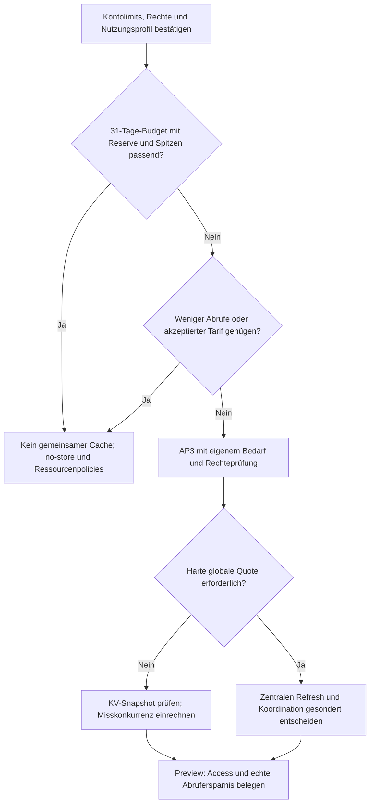

# Phase 2.6 – Marktdatenprovider und tragfähige API-Architektur

Stand: **31. Oktober 2026**, Europe/Berlin. Repository:
`CFPlusPlus/bitcoin-dashboard`. Ausgangscommit:
`7f9ed5c7c974489085988f5b040e1b2574186ce2` (Merge von PR #18).
Branch: `feature/phase-2.6-market-provider-evaluation`.

**AP2 ist Entscheidungsarbeit. Sämtliche folgenden Marktendpunkte, Verträge,
Policies und Infrastrukturvarianten sind Vorschläge, noch nicht implementiert.**
Grundlagen: [Phase 2.4](phase-2.4-data-function-inventory.md),
[Phase 2.5](phase-2.5-difficulty-adjustment.md) und
[ADR 0001](adr/0001-resource-freshness.md). Entscheidungsvorschlag:
[ADR 0002](adr/0002-market-data-provider.md), Status `proposed`.

## 1. Empfehlung und Entscheidungsgrenze

**CoinGecko als einzigen aggregierten Marktprovider vorsehen.** Für AP4 soll
`/coins/bitcoin` beide Fiatwährungen und alle Snapshotkennzahlen mit **einem**
Upstreamabruf liefern. Für AP5 liefert `/coins/bitcoin/market_chart` ausschließlich
die gewählte Preisreihe. Kein automatischer Börsenfallback und kein allgemeines
Providerframework.

Für einen begrenzten privaten Betrieb ist ein Start ohne gemeinsamen Servercache
plausibel: vorgeschlagen sind fünf Minuten Snapshotpolling, 15 Minuten für die
24-h-Reihe und 60 Minuten für 7-/30-d-Reihen. Ein sichtbarer Tab mit acht Stunden
täglicher Nutzung benötigt im Modell einschließlich Reserve rund **5.325 Abrufe
pro 30 Tage**. Zwei solche Tabs überschreiten bereits die mit Reserve nutzbare
Demoquote. Die tatsächliche Nutzung ist unbekannt; dies ist keine Freigabe für
unbeschränkt viele Tabs oder Geräte.

Der ADR bleibt vorgeschlagen, bis Betreiber und Konto die Quote, Rechte,
Nutzungsgrenze und Aktualisierungsanforderung bestätigen. Kein Kauf, neuer Key,
Binding, Deployment oder Access-Eingriff gehört zu dieser Phase. AP3 wird nur bei
belegtem Bedarf geöffnet. Die Cache API wird für die vorhandene Access-Topologie
**nicht als verfügbare Budgetentlastung angerechnet**.

## 2. Evidenz und aktuelle Architektur

| Kennzeichen | Bedeutung und Grenze                                                                |
| ----------- | ----------------------------------------------------------------------------------- |
| C           | Im Ausgangscommit gelesen; keine Aussage über externe Dashboardeinstellungen        |
| D           | Offizielle Dokumentation am Berichtstag geprüft; keine kontobestätigte Berechtigung |
| V           | Konkrete begrenzte Laufzeitbeobachtung mit Pfad und Zeitpunkt                       |
| E           | Eigene Empfehlung, Rechenannahme oder zukünftiges Abnahmekriterium                  |
| Offen       | Ohne Konto-/Betreiber- oder authentifizierten Deploymentnachweis nicht bestätigt    |

**C:** Der anfangs ausgecheckte Phase-2.5-Commit `a4191ae` hat denselben Dateibaum
wie der angeforderte Mergecommit. Nach `git fetch origin main` wurde der neue
Branch direkt auf `7f9ed5c` angelegt. Der Arbeitsbaum war vorher sauber.

Gelesene Implementierungsbasis:

- [Wrangler](../wrangler.jsonc): Pages-Ausgabe `dist`, keine versionierten
  KV-/D1-/Durable-Object-/Service-Bindings.
- [Routing](../public/_routes.json): Functions für `/api/*`;
  [Antworten](../functions/lib/response.ts): `Cache-Control: no-store`.
  Statische `_headers` ersetzen diese Functionheader nicht.
- [Transport](../functions/lib/upstream.ts): begrenzte UTF-8-Streams;
  [Mempool-Adapter](../functions/lib/mempool.ts): feste Quelle, ein Versuch,
  acht Sekunden einschließlich Body, keine Redirects, sichere Fehlerkategorien.
- [Browserclient](../src/lib/bitcoin.ts), [Policy](../src/lib/bitcoin-policy.ts):
  Same-Origin, 15 Sekunden, Laufzeitvalidierung, Querycache pro Browserinstanz.
  Difficulty hat bereits 429/Cooldown einschließlich Erstfehler-Remount;
  die übrigen Ressourcen behandeln Provider-429 weiterhin als 502.
- [Gemeinsame Verträge](../shared/bitcoin.ts) und Validatoren: `updatedAt`
  bedeutet erfolgreichen validierten Abruf, keinen Quellzeitpunkt.

Daraus folgt: sichere Transportschichten und Ressourcenpolicies wiederverwenden,
aber den bisherigen Retryvertrag nicht ungeprüft auf einen quotierten
Marktprovider übertragen. Es gibt im Repository keinen globalen Quotenzähler,
keine tabübergreifende Deduplizierung und keine Marktintegration.

Es wurden **keine Schlüssel oder Secretdateien gelesen**, keine Providerkonten
inspiziert und keine Providerdaten abgerufen. Eine optionale Schema-Probe wurde
ausgelassen; die Dokumentationsbeispiele sind keine Live-Probe. Vor AP4 bleibt
eine einzelne begrenzte, bereinigte Kontoprobe erforderlich (§10).

## 3. Providervergleich mit datierten Primärquellen

Alle Links in diesem Abschnitt wurden am **31.10.2026** geprüft. Tarife sind
veränderliche Listenangaben in USD, keine Angebote oder bestätigten Kontowerte.

### 3.1 CoinGecko: funktional passend, Quote und Rechte noch zu bestätigen

Die Demo-Referenz dokumentiert `/coins/{id}` mit Währungsobjekten unter
`market_data`, einschließlich Preis, Marktkapitalisierung, Volumen, ATH und
währungsbezogenen Änderungen. Vorschlag: fest
`/api/v3/coins/bitcoin?localization=false&tickers=false&market_data=true&sparkline=false`.
Nur USD/EUR normalisieren; Beschreibungen, Bilder, Links und andere Währungen
verwerfen. Kein separater FX-Abruf. Die veralteten Parameter `community_data`
und `developer_data` sind seit August wirkungslos und werden nicht benötigt.
[Coin Data by ID](https://docs.coingecko.com/demo/reference/coins-id).

`/coins/markets?ids=bitcoin&vs_currency=usd&price_change_percentage=24h,7d,30d`
ist eine kleinere Alternative mit passenden Kennzahlen und `last_updated`, aber
einer Zielwährung pro Request. USD und EUR kosten daher zwei Requests statt eines.
`/simple/price` allein deckt ATH/Historie nicht ab. Die 7-d-Sparkline liefert
keinen geeigneten Vertrag mit explizitem Zeitpunkt pro Punkt.
[Markets-Referenz](https://docs.coingecko.com/demo/reference/coins-markets).

| Tarif      | Listenpreis monatlich / bei Jahreszahlung je Monat | Credits/Monat   | Requests/Minute laut Preisseite |
| ---------- | -------------------------------------------------- | --------------- | ------------------------------- |
| Demo       | 0 USD                                              | 10.000          | 100                             |
| Basic      | 35 / 29 USD                                        | 100.000         | 300                             |
| Analyst    | 129 / 103,20 USD                                   | 500.000         | 500                             |
| Lite / Pro | 499 / 999 USD monatlich                            | 2 Mio. / 5 Mio. | 500 / 1.000                     |
| Enterprise | Individuell                                        | Individuell     | Individuell                     |

Die Preisseite nennt Demo-Datenfrische ab 60 Sekunden und Basic ab zehn Sekunden;
das ist keine individuelle SLA. Basic wird als persönlicher Einstieg beschrieben,
Enterprise bietet individuelle SLAs. Bezahlte Tarife werden hier nicht beauftragt.
Monatliche Credits werden kalenderbezogen zurückgesetzt; Overage kann zusätzliche
Kosten erzeugen. [Preise und FAQ](https://www.coingecko.com/en/api/pricing).

**Widerspruch ausdrücklich offen:** Die aktuelle Fehlerreferenz nennt ebenfalls
100 Demo-Requests/Minute. Der offizielle Support nennt weiterhin 30 für ein
registriertes Demo-Konto und 5–15 für schlüssellose Nutzung. Bis zur Kontoklärung
wird mit **höchstens 30/Minute** gerechnet, für geplante Spitzen mit höchstens
24/Minute. Das ist eine konservative Planungsgrenze, kein global implementierter
Limiter und keine Zusage des Providers.
[Fehler/Limits](https://docs.coingecko.com/docs/errors-and-rate-limits),
[abweichender Support](https://support.coingecko.com/articles/5125303456-what-is-the-rate-limit-for-coingecko-api-public-plan).

Demo nutzt serverseitig `x-cg-demo-api-key` an `api.coingecko.com/api/v3`.
Pro-Key und Pro-Host wären eine bewusst konfigurierte Alternative, niemals
automatisches Probieren verschiedener Hosts. Erfolgreiche HTTP-200-Requests
verbrauchen einen Monatscredit. Fehler verbrauchen laut Support keinen
Monatscredit, aber **alle Versuche** zählen gegen das Minutenlimit. Ein 200 mit
für uns ungültigem Schema ist somit trotzdem kostenpflichtig im Creditmodell.
Netzwerk-/Timeoutfehler können nach erfolgreicher Providerverarbeitung auftreten;
wir budgetieren deshalb konservativ auch solche Versuche.
[Authentifizierung](https://docs.coingecko.com/demo/reference/authentication),
[Creditberechnung](https://support.coingecko.com/articles/1864417806-how-does-coingecko-api-count-the-api-usage-credit).

Historie: Demo dokumentiert die letzten 365 Tage. Ohne `interval` gilt ab heute
bei einem Tag ungefähr fünfminütige, bei 2–90 Tagen stündliche und darüber tägliche
Granularität um 00:00 UTC. Der abgeschlossene UTC-Tag ist laut Referenz ab 00:10 UTC
verfügbar. Unser AP5 fordert weder freie Intervallwahl noch `max`.
[Demo-Market-Chart](https://docs.coingecko.com/demo/reference/coins-id-market-chart).
Die offizielle Vergleichshilfe nennt Basic mit zwei Jahren und Analyst aufwärts
mit voller verfügbarer Historie; Datenbeginn und Auflösung hängen zusätzlich vom
Asset ab. Lange Fenster bleiben ein eigener Ausbau, kein „All“-Versprechen.
[Historienvergleich](https://www.coingecko.com/learn/coingecko-api-troubleshooting-guide-and-solutions).

**Speicher-/Nutzungsrahmen:** API-Bedingungen, Fassung 05.09.2025, §4/§6 nennen
Attribution, bei Speicherung Refresh mindestens alle 24 Stunden, starke
Verschlüsselung/Sicherungsmaßnahmen und Löschung nach Zugangsbeendigung. §6 enthält
zugleich eine einschränkende allgemeine Kopier-/Ableitungsklausel. Das wird nicht
als unbeschränktes Archivierungs- oder Weitergaberecht interpretiert. Betreiber
muss kurzfristigen Speicher im Querycache, berechneten ATH-Abstand und ggf. spätere
KV-Haltung ausdrücklich gegen den gewählten Vertragsrahmen bestätigen; bei
Unklarheit Providerklärung vor Integration. Keine Rohdatenarchive im öffentlichen
Repository. [API Terms §4/§6](https://www.coingecko.com/en/api_terms).

Die UI soll gut lesbar **„Powered by CoinGecko“** mit festem Link auf
`https://www.coingecko.com/en/api/` zeigen. Schriftgröße mindestens 10 gemäß
Terms, praktisch die größere vorhandene Metadatenschrift. Ein öffentlicher
Quellcode macht die private Anwendung nicht zu einer Datenweiterverkaufs-API.
Andere Repo-Nutzer brauchen eigene Keys und eigene Rechte; Fixtures vorzugsweise
synthetisch und klar markiert.
[Attributionsleitfaden](https://brand.coingecko.com/resources/attribution-guide).

Ausfälle/429 sind dokumentiert; keine Verfügbarkeitsgarantie für Demo ableiten.
Die API ist versioniert, aber Verhalten und Methodik können sich ändern.
Changelog-/Statusprüfung vor AP4/AP5 und bei Vertragsfehlern einplanen; Zusatzfelder
tolerieren, benötigte Felder streng prüfen. Eine öffentliche Statusseite ersetzt
keine Messung unserer Function. [Changelog](https://docs.coingecko.com/changelog),
[API-Status](https://status.coingecko.com/).

### 3.2 CoinMarketCap: ernsthafte aggregierte Alternative

Aktuelle V3-Referenz: `/v3/cryptocurrency/quotes/latest`,
`/v3/cryptocurrency/quotes/historical`; ergänzend
`/v2/cryptocurrency/price-performance-stats/latest` für Performanceextrema.
Preis, Volumen, Marktkapitalisierung und Änderungen sind abgedeckt, ATH wäre ein
zusätzlicher zu prüfender Vertrag. Historie ist **auch für Basic** dokumentiert:
ein Monat intraday und ein Jahr täglich. Historiencredits zählen je angefangene
100 Punkte; etwa 720 Stundenpunkte kosten acht Credits pro Währung, nicht einen.
Dokumentierte Historienaktualisierung: fünf Minuten. Die aktuellen V3-Formate
können von V1/V2 abweichen.
[Aktuelle Endpunkte und Creditregeln](https://coinmarketcap.com/api/documentation/pro-api-reference/cryptocurrency).

Basic: kostenlos, 15.000 Monatscredits, 50 Requests/Minute, 60 Sekunden Update,
eine Umrechnungswährung pro Call. Builder: angezeigt 29 USD/Monat bei
348 USD/Jahr, 150.000 Credits, 300/Minute; abweichende Monatsabrechnung vor
Tarifwahl prüfen. Die Preisseite erlaubt kommerzielle integrierte
Nutzung auch für Basic, aber keinen eigenständigen Datenweiterverkauf.
Dies ersetzt ältere Pauschalaussagen über „keine kostenlose Historie“.
[Preise/Lizenzübersicht](https://coinmarketcap.com/api/pricing/).

Authentifizierung über `X-CMC_PRO_API_KEY`, Mehrwährungsumrechnung kann zusätzliche
Credits kosten. Kontotatsachen sind unbestätigt.
[Auth und Creditmodell](https://coinmarketcap.com/api/documentation/guides/authentication).
429 unterscheidet Minuten-, Tages-, Monats- und IP-Grenzen. Das erhöht den Bedarf
an kontrollierter Fehlernormalisierung.
[Fehlerreferenz](https://coinmarketcap.com/api/documentation/guides/errors-and-rate-limits).

**Offen:** verbindliche Speicher-/Cache- und Attributionsbedingungen für diesen
konkreten Account. Der von der Preisseite verlinkte
[Commercial-Vertrag](https://pro.coinmarketcap.com/user-agreement-commercial/)
lieferte beim Textabruf nur eine Marketingseite, keinen prüfbaren Vertragstext.
Daraus wird keine Speichererlaubnis abgeleitet. Vergleichsurteil E: fachlich
geeignet, aber für zwei Währungen plus regelmäßig aktualisierte Stundenreihen
komplexeres Creditmodell und kein belegter Vorteil gegenüber CoinGecko.
Bei gescheiterter CoinGecko-Rechteklärung erneut prüfen; kein Laufzeitfallback.

### 3.3 Kraken Spot REST: bewusst andere Datenbedeutung

Öffentliche Marktdaten benötigen keinen Key. `/0/public/Ticker` liefert
börsenbezogene Kurse und 24-h-Werte für BTC/USD und BTC/EUR. Volumen ist in der
Basiswährung zu interpretieren; „heute“ beginnt um 00:00 UTC und ist von rollierenden
24 Stunden zu unterscheiden. Globale Kapitalisierung und ein aggregiertes ATH
sind daraus nicht verfügbar.
[Öffentliche API](https://docs.kraken.com/exchange/guides/overview),
[Ticker](https://docs.kraken.com/api-reference/market-data/get-ticker-information).

`/0/public/OHLC` liefert höchstens 720 jüngste Kerzen, einschließlich der offenen
letzten Kerze. `since` ermöglicht keinen Abruf älterer Punkte. Für 30 Tage
stündlich sind bereits 720 abgeschlossene Punkte nötig; mit offener Kerze ist das
volle Wunschfenster nicht zuverlässig abgedeckt. Gröbere Intervalle oder ein
anderes Archiv wären erforderlich.
[OHLC](https://docs.kraken.com/api-reference/market-data/get-ohlc-data).

Die öffentlichen Limits hängen von IP, bei OHLC/Trades zusätzlich vom Paar ab.
Kraken beschreibt höchstens einen Abruf pro Sekunde als innerhalb der Limits;
weitere Abrufe während einer Sperre können diese verlängern. Kein dokumentiertes
Monatscreditpaket für diese öffentlichen Aufrufe, keine hier bestätigte SLA.
[Rate-Limits](https://support.kraken.com/articles/206548367-what-are-the-api-rate-limits-).
Öffentliche Erreichbarkeit bedeutet keine unbegrenzte Speicher-/Weitergabelizenz;
Attribution und konkrete Wiederverwendungsrechte wären bei Auswahl anhand der
[aktuellen Bedingungen](https://www.kraken.com/legal/global-terms) separat zu
klären. Vergleichsurteil E: brauchbar für einen ausdrücklich als Kraken-Preis
gekennzeichneten Börsenchart, erfüllt unseren aggregierten Gesamtdatensatz nicht.

### 3.4 Entscheidungsmatrix

| Kriterium              | CoinGecko                     | CoinMarketCap                                     | Kraken                               |
| ---------------------- | ----------------------------- | ------------------------------------------------- | ------------------------------------ |
| Aggregierter BTC-Markt | Ja                            | Ja                                                | Einzelbörse                          |
| USD + EUR Snapshot     | Ein Detailrequest             | Free: zwei Calls; Währungs-/Creditregeln beachten | Börsenpaare, keine globale Cap       |
| ATH + Datum            | Im Detaildatensatz            | Zusatzvertrag prüfen                              | Kein aggregiertes ATH                |
| 24 h / 7 d / 30 d      | Demo dokumentiert             | Basic dokumentiert; Credits pro Punktzahl         | 720-Kerzen-Grenze                    |
| Ausbau >1 Jahr         | Tarifwechsel möglich          | Tarif-/Intervallabhängig                          | Anderer historischer Datenpfad nötig |
| Hauptgrenze            | 10.000 Credits + Kontoklärung | Punkte-/Währungscredits + Rechteklärung           | Andere Semantik + Abdeckung          |
| Wahl                   | Bevorzugt, bedingt            | Reservekandidat für neue Entscheidung             | Für diesen Vertrag verworfen         |

## 4. Datenbedeutung und Feldzuordnung

**D:** CoinGecko beschreibt Preisaggregation über berücksichtigte Handelspaare
und die Kapitalisierung als Preis mal definierte Umlaufmenge. Volumen und ATH
hängen von Providerabdeckung und Methodik ab, nicht von einer universellen
Bitcoin-Referenzbörse. **E:** In der UI „aggregierter Referenzkurs“, kein ausführbarer
Kauf-/Verkaufspreis und keine Onchain-Zahl.
[Methodik](https://www.coingecko.com/en/methodology).

`c` bedeutet exakt `usd` oder `eur` im Providerobjekt. Alle folgenden Felder sind
unser vorgeschlagener **Normalisierungsvertrag**; Originalzuordnung gemäß
[Detailreferenz](https://docs.coingecko.com/demo/reference/coins-id).

| Normalisiertes Feld         | Providerfeld / Herkunft                                  | Fachliche Bedeutung / Einheit                                                                     |
| --------------------------- | -------------------------------------------------------- | ------------------------------------------------------------------------------------------------- |
| `price`                     | `market_data.current_price[c]`                           | Fiat je 1 BTC, positiver Referenzkurs                                                             |
| `marketCap`                 | `market_data.market_cap[c]`                              | Fiatwert der Provider-Umlaufmenge; nicht FDV, keine eigene Multiplikation mit 21 Mio.             |
| `volume24h`                 | `market_data.total_volume[c]`                            | Aggregiertes rollierendes 24-h-Handelsvolumen in Fiat; kein Onchainvolumen, keine Kerzensumme     |
| `changePercent.h24`         | `market_data.price_change_percentage_24h_in_currency[c]` | Providerberechnete relative Preisänderung in % in derselben Fiatwährung                           |
| `changePercent.d7` / `.d30` | Entsprechende `7d_in_currency` / `30d_in_currency`       | Providerberechnete 7-/30-d-Änderung in %, soweit vorhanden                                        |
| `ath.price` / `.at`         | `market_data.ath[c]` / `ath_date[c]`                     | Höchster vom Provider erfasster Kurs mit UTC-Zeitpunkt, je Währung separat                        |
| `distanceFromAthPercent`    | Eigene Ableitung `100 × (price / ath.price − 1)`         | Signierter Abstand: −20 bedeutet 20 % unter ATH; nicht nötiger Anstieg bis ATH                    |
| `sourceUpdatedAt`           | `market_data.last_updated`                               | Vom Provider gemeldeter Markt-Datenstand; keine millisekundengenaue Gleichzeitigkeit aller Felder |
| `updatedAt`                 | Functionuhr nach erfolgreicher Validierung               | Abrufzeit als ISO UTC; Semantik von ADR 0001 bleibt erhalten                                      |

Provideränderungen werden nicht aus dem Chart neu berechnet. Beispielsweise sind
0,025 als Verhältnis und 2,5 als Prozentwert verschieden: unser Vertrag enthält
**2,5**. Negative Werte und null sind fachlich verschieden; 0 % ist gültig.
Die 7-/30-d-Werte erfordern somit keine zusätzlichen historischen Requests.
Der Abstand wird aus demselben Snapshot berechnet; `ath_change_percentage` dient
allenfalls als Plausibilitätshinweis, nicht als zweiter verbindlicher Wert.
Ein Kurs oberhalb des gemeldeten ATH wird nicht auf 0 geklemmt: positiver Abstand
und Hinweis auf inkonsistenten Providerstand; kein erfundenes neues ATH.

Historie ist ein eigener Datensatz: `[Unix-Millisekunden, Fiatpreis je BTC]` aus
`prices`. Es sind Preissamples, **keine OHLC-Kerzen und keine lückenlos garantierte
Tradefolge**. `market_caps` und `total_volumes` werden nicht ausgeliefert; insbesondere
dürften rollierende 24-h-Volumenpunkte nicht summiert werden. Ein Samplezeitpunkt
ist kein Publikationszeitpunkt. `sourceUpdatedAt` bleibt für die Reihe `null`,
`lastPointAt` benennt den tatsächlich letzten Punkt. Das letzte Sample kann sich
bei späteren Abrufen ändern. Snapshot und Zeitreihe sind unabhängig abgerufen.

## 5. Kleine additive API und gemeinsame Modelle

### 5.1 Feste Ressourcen und Parameter

| Vorgeschlagener Same-Origin-GET              | Providerabbildung                                          | Upstreamcalls pro Miss |
| -------------------------------------------- | ---------------------------------------------------------- | ---------------------- |
| `/api/market/snapshot`                       | Fester Bitcoin-Detailrequest §3.1, immer USD und EUR       | 1                      |
| `/api/market/history?range=24h&currency=usd` | Fester Bitcoin-`market_chart`, `days=1`, `vs_currency=usd` | 1                      |
| `range=7d` / `30d`, `currency=usd` / `eur`   | Ausschließlich `days=7` / `30`, erlaubte Währung           | 1                      |

Snapshot erlaubt keine Queryparameter. Historie verlangt genau je einen
`range`-/`currency`-Parameter; keine stillen Defaults bei Tippfehlern, keine
unbekannten oder mehrfachen Parameter. Querystring auf 128 ASCII-Zeichen begrenzen;
ungültig → 400 vor jedem Upstreamabruf. Keine frei wählbaren URLs, Asset-IDs,
`from`/`to`, `interval`, `max`, Pagegrößen oder Keyparameter. GET-only, sonst 405
mit `Allow: GET`; unbekannte Ressource → 404, kein SPA-HTML.

Vorgesehene kleine Module: `functions/lib/coingecko.ts`,
`functions/api/market/[resource].ts`, `shared/market.ts`,
`shared/market-validation.ts`, `src/lib/market.ts` und eine kleine Marktpolicy.
Transport/Antwortheader und reine Zahlen-/Zeitprüfer dort wiederverwenden, wo
Semantik passt. Kein Zwang, Mempool-Verträge auf eine generische Providerklasse
umzustellen. Kein SDK und keine neue Produktionsabhängigkeit erforderlich.

### 5.2 Vertragsentwurf, noch kein produktiver TypeScript-Code

```ts
type Currency = 'usd' | 'eur'
type MarketRange = '24h' | '7d' | '30d'

type MarketResponse<T> = {
  data: T
  source: 'coingecko'
  provider: {
    assetId: 'bitcoin'
    market: 'aggregated'
    attributionUrl: 'https://www.coingecko.com/en/api/'
  }
  updatedAt: string // kanonisches ISO UTC, erfolgreicher Abruf
  sourceUpdatedAt: string | null // Snapshot: verpflichtend, Historie: null
}

type MarketQuote = {
  price: number
  marketCap: number | null
  volume24h: number | null
  changePercent: { h24: number | null; d7: number | null; d30: number | null }
  ath: { price: number; at: string } | null
  distanceFromAthPercent: number | null
}

type MarketSnapshot = {
  asset: 'BTC'
  quotes: Record<Currency, MarketQuote>
}

type MarketHistory = {
  asset: 'BTC'
  currency: Currency
  range: MarketRange
  requestedFromMs: number
  requestedToMs: number
  firstPointAt: number
  lastPointAt: number
  nominalIntervalMs: 300000 | 3600000
  points: Array<{ timestampMs: number; price: number }>
}
```

Alle Eigenschaften werden explizit normalisiert. `source`/Metadaten/Attributionslink
sind eigene Konstanten, keine ungeprüften Providerlinks. Kein Providerpayload im
Browserbundle. Zusätzliche Providerfelder dürfen vorhanden sein, verlassen den
Adapter aber nicht. Der Client muss Ressource, Währung und Zeitraum gegen den
angeforderten Query-Key prüfen und nicht nur eine strukturell ähnliche Antwort
akzeptieren.

### 5.3 Validierungsregeln und Grenzen

- Kern: `id=bitcoin`, `symbol=btc`, beide Preise endlich, größer 0 und höchstens
  `Number.MAX_SAFE_INTEGER`. Fehlt ein Kernpreis oder die Marktquellzeit, scheitert
  der gesamte Snapshot; kein stilles EUR-Umrechnen oder USD-Teilerfolg.
- Optionale Kennzahlen: fehlend/null wird explizit `null`, UI zeigt „nicht
  verfügbar“. Vorhandener falscher Typ, NaN, Infinity oder Bereichsverletzung
  macht die Antwort ungültig. Cap/Volumen sind nichtnegative Fiatbeträge, 0 ist
  gültig. Endliche Beträge bis MAX_SAFE_INTEGER, keine Integerpflicht für Fiatwerte.
- Prozentänderungen mindestens −100, höchstens 1.000.000 % als technische
  Plausibilitätsgrenze. Keine Null→0-Konvertierung. ATH nur als vollständiges
  Preis-/Datumspaar; bei fachlich fehlendem Teil gesamtes Paar und Abstand null.
  Typfehler werden nicht als fehlender Wert kaschiert. ATH-Abstand auch im Browser
  mit relativer Toleranz `1e-9 × max(1, |Erwartungswert|)` nachprüfen.
- Zeiten: kanonisches ISO UTC für Hüll-/ATH-Zeiten; sichere ganzzahlige UTC-ms für
  Punkte/Fenster. Nicht vor Bitcoin-Genesis und höchstens fünf Minuten in der
  Zukunft gegenüber der prüfenden Uhr. Kein Sekundenwert im Millisekundenfeld.
  `sourceUpdatedAt <= updatedAt + 5 min`, ATH-Zeit nicht nach Quellzeit + Toleranz.
  Alte korrekte Quellzeit bleibt darstellbar und wird als alt markiert.
- Acht Sekunden Upstream einschließlich Body, 15 Sekunden Browser einschließlich
  Body. Query-Abbruchsignal bei Wechsel/Unmount weitergeben. Ein schon gestarteter
  Upstream kann trotz Browserabbruch zählen; keine Budgetersparnis dafür annehmen.
- Rohantwortlimit: Snapshot **256 KiB**, Historie **1 MiB** einschließlich der
  verworfenen Arrays/Metadaten. Normalisierte Antwort: Snapshot **16 KiB**,
  Historie **80 KiB**; auch Browser liest begrenzt vor `JSON.parse`.
  Limits unabhängig von `Content-Length` durchsetzen, Reader bei Überlauf abbrechen.
  Diese Grenzen sind Entwurfswerte; vor AP4/AP5 anhand einer erlaubten Probe prüfen,
  niemals unbegrenzt als Reaktion auf Schemawachstum erhöhen.

Server validiert Rohdaten vor Ausgabe/etwaiger Speicherung, Browser validiert den
gesamten normalisierten Vertrag vor Querycache. Kein HTML, Redirect oder
unbegrenzt großes Fehlerobjekt wird als Erfolg interpretiert. Geldwerte sind
Analysezahlen mit IEEE-754-Genauigkeit, keine zahlungsgeeigneten Dezimalbeträge.

### 5.4 Zeitreihenvertrag und Granularität

| Auswahl | Providerparameter          | Nominale Auflösung | Typische Punkte        | Harte Obergrenze |
| ------- | -------------------------- | ------------------ | ---------------------- | ---------------- |
| 24 h    | `days=1`, kein `interval`  | 5 min              | ca. 288 plus Randpunkt | 400              |
| 7 d     | `days=7`, kein `interval`  | 1 h                | ca. 168 plus Randpunkt | 200              |
| 30 d    | `days=30`, kein `interval` | 1 h                | ca. 720 plus Randpunkt | 800              |

Dies ist eine Anwendungspolicy auf Basis der dokumentierten Autoauflösung, keine
Garantie einer exakten Punktzahl. `requestedToMs` wird unmittelbar vor dem
Upstreamstart erfasst, `requestedFromMs = requestedToMs − range`; der Provider
wählt sein eigenes „jetzt“. Punkte dürfen höchstens ein nominales Intervall vor
dem Fensterbeginn und höchstens fünf Minuten nach dem Fensterende liegen;
außerdem nie nach `updatedAt + 5 min`. Der tatsächliche Beginn/Endpunkt wird separat
ausgewiesen, keine synthetischen Randpunkte erzeugen.

Zwei oder mehr gültige, strikt aufsteigende, eindeutige Punkte verlangen. Nullpreise,
fehlende Paare, unsortierte oder doppelte Zeitpunkte, Caps-/Byteüberschreitung
verwerfen; nicht durch Sortieren, Abschneiden oder Interpolation verstecken.
Ein kleiner vorhandener Rest einer lückenhaften Reihe darf als Teilabdeckung
gezeigt werden, aber niemals als vollständige 30 Tage. Nominalauflösung im Vertrag
ist nur der erwartete Takt, kein Beleg lückenloser Abdeckung. Abstände größer
`2 × nominalIntervalMs` werden im Chart unterbrochen und als Datenlücke benannt;
beide realen Randpunkte bleiben erhalten. Ein Wechsel auf gröbere systematische
Auflösung ist als unpassender Vertrag zu behandeln, nicht als vermeintlich viele
Lücken. AP5 testet dafür insbesondere eine tägliche statt stündliche 30-d-Reihe.

`lastPointAt` misst den letzten historischen Beobachtungszeitpunkt; nicht mit
`sourceUpdatedAt` oder `updatedAt` überschreiben. Eine Chartänderung vom ersten
zum letzten Punkt wäre `100 × (p_last / p_first − 1)` über den **tatsächlichen**
Punktabstand und dürfte nur als solche beschriftet werden. AP5 benötigt diese
Zusatzkennzahl zunächst nicht.

## 6. Abrufbudget ohne gemeinsamen Cache

### 6.1 Annahmen und Formel

Keine tatsächlichen Nutzungszahlen oder Kontocredits liegen vor. Für das Modell
zählt jede sichtbare Browserinstanz separat, auch zwei Fenster desselben Geräts.
Hintergrund-/Offlinezeit pollt nicht. Ein QueryClient teilt denselben Key zwischen
Komponenten und Routen; neue Tabs, Geräte und vollständige Reloads teilen ihn nicht.
HTTP-Antworten bleiben `no-store`. Keine dauerhafte Hintergrundabfrage und kein
Vorabladen aller sechs Historienkombinationen.

Für jede sichtbare Sitzung `b` mit Stunden `h` und Intervall `i` in Minuten:

```text
P_snapshot = Σ_b ceil(60 × h_snapshot,b / i_snapshot)
             + C_snapshot + F_snapshot + M_snapshot
P_history  = Σ_b,range,currency ceil(60 × h_history,b,range,currency / i_range)
             + C_history + F_history + M_history
P_day      = P_snapshot + P_history
A_day      = P_day + R_day
Plan_month = ceil(1,25 × D × P_day)
```

`C`: zusätzliche kalte Abrufe durch Öffnen, Reload, GC und erstmals gewählte
Historykeys. `F`: zusätzliche stale Fokus-/Reconnect-/Remountabrufe.
`M`: akzeptierte manuelle Refreshs, jeder verursacht pro betroffener Ressource
einen Abruf. `R`: tatsächlich gestartete Wiederholungen. Die Ceil-Terme sind eine
konservative obere Zählung periodischer Abrufe pro Sitzung; kalte Starts werden
zusätzlich gerechnet, auch wenn dadurch ein Randabruf doppelt kalkuliert wird.
Sitzungen bei Unterbrechungen einzeln summieren, nicht nur Stunden mitteln.

**Reserve:** 25 % auf die geplanten Grundabrufe: zehn Prozentpunkte für
Transientfehler/Retry und 15 für unvorhergesehene Reloads/Wechsel/Spitzen. Alternativ
gemessene Retries separat addieren und verbleibende Reserve neu rechnen, nicht
doppelt addieren. Bei 10.000 Credits sind höchstens **8.000 geplante Grundabrufe**
freigabefähig. Ein Ausfall kann mehr als 10 % Retrybedarf erzeugen; Reserve ist
keine Worst-Case-Garantie. Ohne globales Budget kann beliebiges manuelles Reloaden
die Quote ausschöpfen. Auch andere Anwendungen, Preview, Schema-Probe und
Entwicklung auf demselben Konto gehören in die Gesamtsumme.

### 6.2 Plausible Szenarien

Historie läuft in A–E als ausgewählte 24-h-Reihe während derselben sichtbaren
Stunden. Seltene Aufrufe von 7 d/30 d oder EUR stecken in `C_history`. Wiederholtes
Wechseln nach Stale/GC erhöht `C/F`; aktive Historienzeit wird dann dem jeweiligen
Key zugeordnet, nicht für alle Zeiträume zugleich gezählt.

| Szenario                      | Sichtbare Tabs × Stunden/Tag | Snapshot / Historie | Snapshot C/F/M | Historie C/F/M |
| ----------------------------- | ---------------------------- | ------------------- | -------------- | -------------- |
| A: gelegentlich               | 1 × 2 h                      | 5 / 15 min          | 2/2/1          | 2/1/0          |
| B: Arbeitstag                 | 1 × 8 h                      | 5 / 15 min          | 2/4/2          | 3/2/1          |
| C: zwei Tabs                  | 2 × 8 h                      | 5 / 15 min          | 4/8/4          | 6/4/2          |
| D: zwei Geräte, je zwei Tabs  | 4 × 8 h                      | 5 / 15 min          | 8/16/8         | 12/8/4         |
| E: dauerhaftes Minutenpolling | 1 × 24 h                     | 1 / 15 min          | 1/2/2          | 3/2/1          |
| F: langsamere Option für D    | 4 × 8 h                      | 15 / 60 min         | 8/16/8         | 12/8/4         |

| Szenario | Snapshot/Tag | Historie/Tag | Gesamt/Tag ohne Reserve | 30 Tage ohne Reserve | 30 Tage inkl. 25 % | 31 Tage inkl. 25 % |
| -------- | ------------ | ------------ | ----------------------- | -------------------- | ------------------ | ------------------ |
| A        | 29           | 11           | 40                      | 1.200                | 1.500              | 1.550              |
| B        | 104          | 38           | 142                     | 4.260                | 5.325              | 5.503              |
| C        | 208          | 76           | 284                     | 8.520                | 10.650             | 11.005             |
| D        | 416          | 152          | 568                     | 17.040               | 21.300             | 22.010             |
| E        | 1.445        | 102          | 1.547                   | 46.410               | 58.013             | 59.947             |
| F        | 160          | 56           | 216                     | 6.480                | 8.100              | 8.370              |

Beispiel B: `8×60/5 + 2+4+2 = 104`; Historie `8×60/15 + 3+2+1 = 38`.
Nur AP4: B kostet mit Reserve **3.900/30 Tage**; AP5 addiert **1.425**.
Bei C passt nur AP4 mit 7.800/30 Tage bzw. 8.060/31 Tage einschließlich Reserve;
die zusätzliche Historie überschreitet die Quote. Deshalb das AP5-Budget vor
dessen Abnahme separat bestätigen.
Eine achtstündige 7-/30-d-Ansicht braucht bei 60-Minuten-Policy acht periodische
Historycalls statt 32 bei 24 h; Zeitraumwahl beeinflusst den Bedarf.

Ergebnis E: A/B plausibel ohne neue Infrastruktur; C–E passen unter den Annahmen
nicht zum Demo-Rahmen. F passt, verlangt aber eine ausdrückliche Akzeptanz des
höheren Datenalters samt angepasster Warnschwellen. Tarifupgrade und reduzierte
Frequenz sind vor Cacheinfrastruktur zu vergleichen. Keine Kostenautomatik.

### 6.3 Spitzen und Fehlerlast

Vier gleichzeitig gestartete Tabs erzeugen mit gewählter Historie acht Requests
in kurzer Zeit, nicht nur ihren kleinen Tagesdurchschnitt. Zwei zusätzliche kalte
Historykeys je Tab erhöhen diese Minute auf 16. Bei einmaligem Retry wären bis
zu 32 Versuche möglich und damit mehr als die konservativen 30/Minute. Daher
kein automatisches Vorladen, keine gleichzeitige manuelle Aktualisierung aller
Fenster und kein optimistischer Schluss aus der Monatsquote auf Minutenlimits.

Vorschlag E: im Marktclient höchstens ein aktiver Marktrequest pro QueryClient,
keine doppelte Queue desselben Keys, manueller Refresh frühestens 60 Sekunden
nach dessen letztem Versuch, eine kurze zufällige Verzögerung für automatische
Retries. Das reduziert Spitzen innerhalb eines Tabs, koordiniert keine Geräte.
Neue Tabs/Reload umgehen diese lokale Pause. Braucht der Betreiber eine harte
globale Minutengrenze, muss AP3 sie tatsächlich koordinieren; KV allein tut das
nicht. Keine Belastungsprobe gegen Gratisprovider.

## 7. Cacheentscheidung in der tatsächlichen Pages-/Access-Topologie

### 7.1 Laufzeitbeobachtung und deren Grenze

**V:** Je ein anonymer GET auf `/api/health`, ohne Cookies/Authorization, mit
12-s-Grenze und `redirect: manual`. Body sofort verworfen; nur Status,
Content-Type, Cache-Control und bereinigte Redirectdestination ausgewertet.

| Host                              | UTC-Zeit 31.10.2026 | Beobachtung                                                                      |
| --------------------------------- | ------------------- | -------------------------------------------------------------------------------- |
| `bitcoin.falkner.info`            | 14:57:05.762        | 302 zu `falkner-info-pages.cloudflareaccess.com` unter `/cdn-cgi/access/login/…` |
| `bitcoin-dashboard-erm.pages.dev` | 14:57:05.899        | 302 zu demselben Access-Host unter `/cdn-cgi/access/login/…`                     |

Beide Antworten: `text/html`, `private`/`no-store`/`no-cache`, kein
`CF-Cache-Status`. Kein App-JSON gesehen, Login nicht verfolgt, keine
Redirectquery, Cookies oder Tokens gespeichert. Das bestätigt Access vor diesen
zwei Pfaden **zu diesen Zeiten**. Es beweist weder Schutz aller Assets/Hosts noch
Cachehits, authentifizierte Functionausführung oder das deployte SHA. Keine
Cache-/Access-Konfiguration wurde verändert. Bestehende vollständige
[Releaseprüfung](cloudflare-pages-verification.md#manual-external-access-verification-separate-release-gate)
bleibt separat erforderlich.

### 7.2 Was tatsächlich unterstützt bzw. unbewiesen ist

| Ebene                            | Befund                                                                                                                                    | Konsequenz für Budget                                                            |
| -------------------------------- | ----------------------------------------------------------------------------------------------------------------------------------------- | -------------------------------------------------------------------------------- |
| TanStack Query im Browser        | C: Speicher pro QueryClient, gleiche Keys werden geteilt; nicht zwischen Tabs/Geräten                                                     | In obiger Rechnung enthalten; kein globaler Cache                                |
| HTTP-Browsercache                | C: Function und Fetch `no-store`                                                                                                          | Keine Wiederverwendung nach Reload anrechnen                                     |
| HTTP/CDN-Responsecache           | Keine API-Cacheregel im Repo; Access-Login beobachtet, Kontoregeln unbekannt                                                              | Nicht als Ersparnis anrechnen; `no-store` beibehalten                            |
| `caches.default` / `caches.open` | D: Pages allgemein unterstützt; Cloudflare nennt Cache API vor Access-Workers aktuell nicht verfügbar; Inhalte sonst nur je Rechenzentrum | Für unsere geschützten API-Pfade kein nachgewiesener nutzbarer gemeinsamer Cache |
| Modulglobaler Speicher / Promise | Keine Lebensdauer-/Instanz-/Standortgarantie                                                                                              | Allenfalls opportunistische Entlastung, kein Quotenschutz                        |
| KV über Pages-Binding            | D: unterstützte persistente Ressource, C: nicht im Repo konfiguriert; externes Dashboard unbestätigt                                      | Erst AP3 bei Bedarf, keine Annahme über bestehendes Binding                      |
| Durable Object / Service         | D: Binding zu separatem Worker möglich, kein DO-Deployment innerhalb Pages                                                                | Nur bei belegtem Bedarf an zentraler Koordination                                |

Die maßgebliche Referenz unterscheidet ausdrücklich Pages-Unterstützung,
Standortlokalität, wirkungslose Playgroundoperationen und Access-Einschränkung.
Ein lokaler Wrangler-Test, vorhandene TypeScript-Typen oder ein Header
`CF-Cache-Status` allein belegen deshalb keinen realen Hit mit gespartem
Providerabruf. Auch `fetch`-Caching darf nicht ohne konkreten Nachweis als
Umgehung der Cache-API-Grenze eingeplant werden.
[Cloudflare Cache API](https://developers.cloudflare.com/workers/runtime-apis/cache/).

Pages kann KV und Services binden; Durable Objects müssen in einem separaten
Worker existieren. [Pages-Bindings](https://developers.cloudflare.com/pages/functions/bindings/).
KV ist eventual consistent; auch Misses werden gecacht, andere Standorte können
Änderungen verzögert sehen. Gleichzeitige Misses/Refreshs und verlorene
Zählerupdates verhindern einen verlässlichen globalen Lock/Quotenzähler.
[KV-Konsistenz](https://developers.cloudflare.com/kv/concepts/how-kv-works/).

### 7.3 Entscheidungsbaum und bedingte AP3-Option



**Derzeitige Empfehlung E:** kein zusätzlicher gemeinsamer Cache für ein
bestätigtes A/B-Profil. Es fehlen reale Nutzungsdaten; ein allgemeiner Bedarf für
KV/DO/Scheduler ist damit nicht nachgewiesen. Falls C/D tatsächlich gebraucht
wird, ist der Mehrbedarf nachweisbar und die Wahl zwischen F, Tarif und AP3 konkret.

Falls später KV gewählt wird: nur validierte öffentliche Payloads je festem
Ressourcen-/Währungs-/Zeitraumkey speichern. Als Startwerte interne Fresh-TTL
entsprechend §8, Höchstaufbewahrung 24 h, keine unbegrenzt wachsende Historie.
TTL ersetzt keine Aktualitätsprüfung: `updatedAt` und Quell-/Punktzeiten bleiben
unverändert. Fehler beim Refresh überschreiben keinen Erfolg. Snapshot älter als
30 Minuten bzw. Historie älter als drei Stunden nicht als aktuellen Ersatz
ausliefern; sichtbare Stale-Kennzeichnung bleibt erforderlich. Rechte und genaue
TTL werden in AP3 erneut bestätigt; Miss-Refresh ist kein garantiertes Monatsbudget.

In einem kontrollierten geschützten Preview später zwei autorisierte Requests auf
denselben Key ausführen: identischer gespeicherter Abrufzeitpunkt und **ein**
tatsächlicher Upstreamcall innerhalb TTL nachweisen. Ablauf, Fehler und konkurrierende
Misses mit Fixtures sowie reale zweite Region prüfen, wenn dafür globaler Nutzen
behauptet wird. Anonymer GET muss weiterhin nur Accessantwort erhalten. Nur
bereinigte Zähler/Keyklasse/Hits dokumentieren, keine Authdaten. Keine Access-Ausnahme,
öffentliche Cache-Route, Cookieentfernung zur Sicherheitsumgehung oder globale
„Cache Everything“-Regel. Auslieferung zum Browser bleibt `no-store`.

## 8. Ressourcenfrische und sichere Fehler

### 8.1 Vorgeschlagene Policies nach ADR 0001

| Ressource                 | Query-stale / sichtbares Polling | UI-Warnung Abrufalter | Zusätzliche fachliche Warnung                                 | GC inaktiv |
| ------------------------- | -------------------------------- | --------------------- | ------------------------------------------------------------- | ---------- |
| Snapshot beider Währungen | 5 min                            | 10 min                | Marktquellzeit älter als 10 min                               | 30 min     |
| 24-h-Preisreihe           | 15 min                           | 30 min                | Letzter Punkt älter als 30 min; Teilabdeckung/Lücken separat  | 30 min     |
| 7-/30-d-Preisreihe        | 60 min                           | 120 min               | Letzter Punkt älter als 120 min; Teilabdeckung/Lücken separat | 30 min     |

Diese Werte sind Produktentscheidungen, keine behaupteten Publikationsintervalle.
Warnschwelle heißt „ab diesem Alter“. Alter im sichtbaren UI mit lokaler Uhr alle
30 Sekunden und beim Sichtbarwerden prüfen, ohne zusätzliche Providerrequests.
Ein frisch abgerufener alter Datensatz bleibt als alter Quellstand erkennbar.
Fehler und Alterswarnung sind unabhängig. Querycache-GC ist kein Frischekriterium.

Nur aktive Ressourcen der Marktseite pollen. Snapshotkey z. B.
`['market','snapshot']`; Historie `['market','history',currency,range]`. USD/EUR-
Wechsel nutzt denselben Snapshot; Historie wird bei Bedarf geladen. Verborgene
Tabs/offline/inaktive Routen pausieren, stale Rückkehr/Reconnect aktualisiert
einmal. Manuelles Refresh wirkt nur auf die angeforderte Ressource, respektiert
429 und die 60-s-Pause. Kein Poll pro KPI, kein Cross-Tab-/Service-Workerprojekt.

### 8.2 Fehlervertrag ausschließlich für neue Marktressourcen

| Ursache                                                  | Dashboardantwort / Verhalten                                                      |
| -------------------------------------------------------- | --------------------------------------------------------------------------------- |
| Ungültige Parameter / unbekannter Pfad / falsche Methode | 400 `INVALID_REQUEST` / 404 `NOT_FOUND` / 405 `METHOD_NOT_ALLOWED`                |
| Secret für Umgebung fehlt                                | 503 `MARKET_NOT_CONFIGURED`, kein Upstreamabruf und kein Browserretry             |
| Provider-429                                             | 429 `UPSTREAM_RATE_LIMIT`, eigene Mindestpause 600 s                              |
| Timeout                                                  | 504 `UPSTREAM_TIMEOUT`                                                            |
| Netzwerk / Provider-5xx                                  | 502 `UPSTREAM_UNAVAILABLE`                                                        |
| Provider-401/403 / tarifbedingt fehlende Berechtigung    | 502 `UPSTREAM_CONFIGURATION`, kein Retry; kein falscher Hinweis auf Access-Logout |
| Schemafehler / zu große Antwort                          | 502 `UPSTREAM_INVALID_RESPONSE`, kein automatischer Retry                         |
| Browserseitige Access-401/403, Loginredirect/-HTML       | Zugriff-/Verbindungshinweis mit Neuladen; kein erfolgreicher Datencache           |

Sichere Hülle: `{ error: { code, retryAfterSeconds? } }`, nur eigene Codes und
validierte kleine Werte; kein Upstreamtext oder durchgereichter Header. Bei 429
`Retry-After: 600` und `retryAfterSeconds: 600`. Das ist unsere Mindestpause und
keine Zusage, wann Monats-/Minutenlimit endet. Monatlich erschöpfte Quote wird
nicht zuverlässig allein am 429 erkannt; bei wiederholter Sperre Betreiberkonto
prüfen und Abrufe betrieblich pausieren statt neue Keys/Hosts zu versuchen.

Kein Serverretry. Im Browser maximal **ein** automatischer Retry für Netzwerk,
Timeout und `UPSTREAM_UNAVAILABLE`, frühestens nach fünf Sekunden plus bis zu
fünf Sekunden Jitter. Validierte Errorcodes trennen Schema-/Konfigurationsfehler
von transientem 502; unbekannte/kaputte Fehlerhüllen konservativ ohne Retry.
429 pausiert **alle Marktkeys desselben QueryClients** zehn Minuten, einschließlich
Mount, Erstfehler-Remount, Fokus, Reconnect, Polling und manueller Buttons.
Bereits gestartete Requests lassen sich nicht sicher rückgängig machen.
Gemeinsam ist nur die Marktproviderpause, keine Änderung der Mempool-Policies.
Neuladen, andere Tabs und Functioninstanzen teilen sie nicht.

Nach Refreshfehler bleibt der letzte validierte Erfolg einschließlich aller Zeiten
sichtbar. Kein Demofallback, keine Nullwerte als 0, keine Providerumschaltung.
Logs nur Event, Ressource, Kategorie, Providerstatus, Dauer/Bytezahl und optional
bereinigter Cachehit; keine URLs mit Query, Header, Bodies, Cookies, Keys oder
Fehlerstacks. Securityheader und fehlende CORS-Freigabe bleiben erhalten.

## 9. Schlüsselverwaltung und Betriebsrahmen

Ein Marktkey wird später ausschließlich als serverseitiges Pages-Secret über
`context.env` injiziert. Nie `VITE_*`, Frontendkonfiguration, Querystring,
Dokumentationscurl mit echtem Key, GitHub-Secretkopie oder Provider-SDK im Browser.
Der Adapter erzeugt den Upstreamrequest neu: nur eigener Accept- und Keyheader,
keine Weitergabe von Browser-Cookies, Access-JWT oder Authorization; Redirects
werden abgelehnt. Fehlerantworten zum Browser auf 4 KiB begrenzen; Providerfehler-
bodies verwerfen, statt sie für Diagnosen zu protokollieren oder weiterzureichen.
Lokale Secrets nur in ignorierter `.dev.vars`, sofern der Betreiber AP4 dafür
gesondert freigibt. Production/Preview getrennt budgetieren; Preview nicht
automatisch annehmen. In dieser Phase wird nichts angelegt oder geändert.

Der vorhandene Same-Origin-Pfad ist ausreichend; neue Routes müssen vom gleichen
Accessschutz erfasst sein. Access verwaltet Authentifizierung, nicht die
Providerquote. Keine Änderungen an Access. Ein öffentliches Repository enthält
nur Code, Quellenlinks, synthetische Testfixtures und bereinigte Nachweise.

Für den ersten freigegebenen Betrieb E: 0-USD-Demo nur bei bestätigter Eignung,
31-Tage-Modell unter 10.000 einschließlich Reserve und keinem anderen unberücksichtigten
Verbraucher. Kein automatisches Upgrade, Overage oder Ersatzkey. Nach einer Woche
und nach dem ersten vollständigen Kalendermonat Betreiberverbrauch mit dem Modell
vergleichen. Bei Prognose über 80 % der Quote, wiederholtem 429 oder geändertem
Nutzungsprofil Frequenz/Tarif/AP3 neu entscheiden; nicht bis zum Ausfall warten.
Accountwerte nur zusammengefasst ohne Key oder Abrechnungspersonalien dokumentieren.

## 10. Offene Freigabepunkte vor AP4/AP5

| Punkt              | Benötigter Nachweis / Verantwortlichkeit                                                                                                            | Aktueller Status                        |
| ------------------ | --------------------------------------------------------------------------------------------------------------------------------------------------- | --------------------------------------- |
| Tarif/Kontolimits  | Betreiber bestätigt Tarif, Monats-/Minutenquote, Reset, sonstigen Verbrauch und Overageeinstellung ohne Secret                                      | Nicht kontoverifiziert                  |
| Usage              | Betreiber bestätigt sichtbare Stunden, Tabs/Geräte, Reloads, Refreshs; 31-Tage-Rechnung aktualisieren                                               | Nur A–F-Annahmen                        |
| Rechte             | Betreiber bestätigt private integrierte Anzeige, Attribution, kurzfristigen Speicher und ATH-Ableitung; ggf. Providerklärung                        | D dokumentiert, konkrete Freigabe offen |
| Schema/Größe       | Eine authentifizierte Probe des festen Snapshotrequests, Timeout/Bytecap; nur Typen, Feldvorhandensein, Zeitsemantik, Größe, Status veröffentlichen | Nicht durchgeführt                      |
| Historienfähigkeit | Vor AP5 je benötigtes Fenster/Währung deterministisch testen; Tarifberechtigung bestätigen; keine externe Pflichtsuite                              | D dokumentiert, Konto offen             |
| Topologie          | Authentifizierter Preview-/Releasepfad, deploytes SHA und Access-Hostkatalog gemäß bestehendem Releasegate                                          | Zwei anonyme Healthpfade V; Rest offen  |
| Cache              | Bei bestätigtem A/B-Profil explizit „kein gemeinsamer Cache“ freigeben; bei Mehrbedarf AP3 entscheiden                                              | E bedingt                               |

Eine spätere Provider-Schema-Probe ist kein Lasttest: ein fester GET, höchstens
256 KiB/12 Sekunden, keine automatische Wiederholung und keine Weitergabe von
Requestheadern/Fehlerbody. Kein Kontoschlüssel wird für diese Planungsphase gesucht.
Für AP5 gelten getrennte, gezielt begrenzte Abdeckungsnachweise; kein stiller
Übergang von „Probe“ zu regelmäßigem Polling.

## 11. AP4 – echter Marktsnapshot, einzeln abnehmbar

**Umfang:** ein Adapter, ein normalisierter Snapshot-GET, gemeinsame Validatoren,
Marktquery/-policy und ein klar begrenzter Snapshotabschnitt der Marktseite.
Zwingend BTC/USD und BTC/EUR, währungsbezogene 24-h-Änderung, Cap und Volumen;
7-/30-d-Änderung und ATH/Datum/Abstand gemäß Nullvertrag ohne Extraabrufe.
Der Auftrag konkretisiert damit den USD-Start aus Phase 2.4 um das hier verlangte
EUR und die direkt im Snapshot verfügbaren ATH-Felder. Keine Chart-/Historienabhängigkeit.

Abnahmekriterien:

1. Gates aus §10 für AP4 erfüllt und ADR ausdrücklich angenommen; sofern AP3
   tatsächlich nötig ist, dessen eigener Nachweis zuerst. Testfixtures ersetzen
   keine Kontofreigabe, ein angenommener ADR ist keine automatische Deploymentfreigabe.
2. Genau ein fester Detailrequest pro Snapshotversuch; USD/EUR im selben Envelope,
   keine Requests pro KPI/FX. Alle normalisierten Felder und Zeitsemantiken aus §4/5
   getestet, Quellen-/Attributionszeile sichtbar. Fehlende optionale Werte korrekt.
3. Deterministisch Raw → Adapter → Function → Browservalidator prüfen: Null/0,
   negative Änderung, falsche Fiatwährung/Asset, ungültige Quellzeit, altes
   Quellsample bei frischem Abruf, ATH-Paar/Abstandsformel, unbekannte Zusatzfelder.
4. Timeout während Body, falsches/fehlendes Content-Length, Stream-/UTF-8-Fehler,
   Redirect/HTML, Bytecaps, Secret fehlt, Provider-401/403/429/5xx und sichere
   Errorcodes geprüft. Keine Secrets in Ausgabe, Bundle, Logs oder Snapshots.
5. Querytests: fünf Minuten, Hintergrundpause, Wiederkehr, geteilte KPIqueries,
   lokaler providerweiter 429-Cooldown auch bei Remount/manuell, begrenzter Retry,
   alter Erfolg bleibt bei Refreshfehler erhalten. Ohne aktive Marktseite kein Poll.
6. UI mit Lade-/Erst-/Refreshfehler und getrenntem Quell-/Abrufalter, USD/EUR-
   Kennzeichnung, Formatierung mit tabellarischen Ziffern, Fokus und Tastaturretry.
   Bitcoin Analytical: bestehende Manrope/Inter-Tokens, Blau für Daten, Orange für
   Interaktion, keine neue Informationsarchitektur für andere Seiten.
7. Bestehender Demochart bleibt ausdrücklich Demo, bis AP5 getrennt abgenommen ist.
   Lint, Format, Typecheck, Unit, Build, Pages-Compile und lokale Chromium-E2E grün;
   externe Providerrequests sind keine CI-Voraussetzung. Eigener PR nur für AP4.

## 12. AP5 – Historie und Marktvisualisierung, einzeln abnehmbar

**Voraussetzung:** AP4 angenommen; Historyrechte/-budget und Kontofähigkeit aus
§10 bestätigt. Dieser ADR legt bereits den initialen Zeitreihenvertrag fest,
anstatt eine unentschiedene zweite Grundsatzarchitektur vorauszusetzen.
**Umfang:** Preisreihe für 24 h / 7 d / 30 d, USD/EUR-Auswahl, begrenzter
Historyendpoint und Marktansicht. Kein Volumenchart, Mining-/Übersichtsumbau,
Dominanz, Sentiment oder eigenes Langzeitarchiv.

Abnahmekriterien:

1. Alle sechs erlaubten Keykombinationen mit kontrollierten Fixtures getestet;
   nur der gewählte Key wird angefragt. 400/404/405 vor Upstream, unbekannte,
   doppelte, zu lange und manipulierte Parameter einschließlich URLversuchen geprüft.
2. Millisekunden, Fenstergrenzen, Punkt-/Bytecaps, strikt aufsteigende Eindeutigkeit,
   leer/ein Punkt, null/NaN, Sekundenfehler, falscher Zeitraum/Währung, grobe
   unerwartete Auflösung und Lücken getestet. Keine künstlichen Kurs-/Randpunkte.
   Teilabdeckung, offene letzte Beobachtung und tatsächliche Auflösung sichtbar.
3. Query-Key/Cachetrennung, kein Vorladen, 15-/60-Minuten-Policy, 429 über Snapshot
   und Historie hinweg, Abort und schnelle Wechsel mit überholten Antworten
   deterministisch geprüft. Ein alter USD-Request überschreibt nie EUR/7 d.
4. Chart mit echter Zeitachse (UTC-ms intern, eindeutig benannte lokale Zeitzone im
   Tooltip), Fiatpreisachse und festen Einheiten. Keine Indexwerte P1–P12, keine
   scheinbaren Kerzen oder Volumensummen. Fehlende Intervalle unterbrechen Linien.
   Snapshotänderung nicht als Änderung zwischen Chartrandpunkten umetikettieren.
5. Analytical-konforme ruhige Preis-Hauptfläche, Statistikzeilen, Quellen-/
   Attributionszeile und zurückhaltende Zeitraumwahl; keine Kopie der Blockchain-
   Kartenkomposition. Auswahl als zugängliche Buttons, sichtbarer Fokus, mindestens
   44 px Touchhöhe, ausgewählter Zustand semantisch erkennbar. Punktinspektion
   per Touch/Tastatur und textliche Zusammenfassung als Chartalternative.
6. ECharts lazy laden, Resize/Dispose/Themewechsel/Renderfehler geprüft. Dark/Light
   und 320/390/768/1440/1920 px sowie 200 % Text prüfen; kontrollierte Screenshots
   als Fixtures kennzeichnen und tatsächlich visuell beurteilen.
7. Erst-/Refreshfehler, Stale, Quell-/Punktalter, Lücken und Teilabdeckung erkennbar;
   kein Demo-Fallback. Budget inklusive History und 31 Tage erneut abnehmen.
   Dieselben lokalen Qualitätsprüfungen wie AP4, keine Live-API-Pflicht in CI.
   AP5 hat eigenen PR und funktioniert auf AP4 ohne weitere Marktprojekte.

Längere Zeiträume erst nach neuer Tarif-/Abdeckungs-/Granularitäts-/Pointcapprüfung
ergänzen: ab >90 Tagen tägliche Samples bewusst benennen, kein naives Vergrößern
des 800-Punkte-Vertrags. Ein Zeitfenster ist nicht dasselbe wie voller
historischer Datenbeginn.

## 13. Risiken und spätere Überprüfung

| Risiko                                          | Behandlung / erneuter Entscheidungsauslöser                                                     |
| ----------------------------------------------- | ----------------------------------------------------------------------------------------------- |
| Tarif-/Dokumentationsänderung                   | Konto statt Marketing als Freigabebasis; vor AP4/AP5 und mindestens quartalsweise erneut prüfen |
| Mehr Tabs/andere Accountverbraucher             | Betreiberquote nach Woche/Monat abgleichen; ab 80-%-Prognose Frequenz/Tarif/AP3                 |
| 429 trotz kleiner Durchschnittslast             | Minutenbursts und geteilten Egress beachten; keine Retrykaskade oder Keyrotation                |
| Alter Marktstand trotz HTTP 200                 | Quellzeit/Punktalter zusätzlich zu Abrufzeit, keine „Live“-Garantie                             |
| Gleiche Schemaform, andere Methodik             | Changelogprüfung; Datenbedeutung erneut abnehmen, nicht nur Parser lockern                      |
| Rechte für Speicher/Ableitung unklar            | ADR proposed lassen; vor Nutzung klären, keine öffentliche Datenarchivierung                    |
| KV wird fälschlich als globale Sperre verwendet | Bei Bedarf AP3 mit Konkurrenz-/Regionsnachweis; harte Quote separat koordinieren                |
| Fehlender authentifizierter Topologienachweis   | Keine Cacheersparnis behaupten; vorhandenes Releasegate vor Produktivabnahme                    |

## 14. Nachweise dieser Dokumentationsphase

Geändert werden ausschließlich dieser Bericht und ADR 0002. Kein produktiver
Endpunkt, Secret, Binding, Accessschutz, Paket oder API-Vertrag wird implementiert.
Die Quotenrechnung wurde separat arithmetisch geprüft; alle offiziellen
Quellenlinks wurden während der Recherche aufgerufen. Zwei Health-GETs aus §7
sind die einzigen hier vorgenommenen Produktionsproben und keine Providerprobe.

Lokal erneut ausgeführt mit der vorhandenen Installation und der vorgegebenen
Toolchain **Node 22.22.2 / npm 10.9.7**; kein erneutes `npm ci`, keine Änderungen
am Lockfile. Ergebnisse dieser Phase:

| Prüfung                | Ergebnis                                                                                          |
| ---------------------- | ------------------------------------------------------------------------------------------------- |
| `npm run lint`         | PASS, keine Warnungen                                                                             |
| `npm run format:check` | PASS, gesamtes Repository                                                                         |
| `npm run typecheck`    | PASS, alle vier Teilprojekte                                                                      |
| `npm test`             | PASS, 308 Tests in 15 Dateien                                                                     |
| `npm run build`        | PASS, einschließlich Typecheck                                                                    |
| `npm run pages:check`  | PASS, Worker kompiliert                                                                           |
| `npm run test:e2e`     | PASS, 86 Chromium-Tests, 40,4 s                                                                   |
| Dokumentprüfung        | Relative Dateilinks gültig, Budgettabellen nachgerechnet, Diff auf zwei Markdown-Dateien begrenzt |

Der erste sandboxierte Pages-Compile scheiterte an Wrangler-Logrechten und
Verzeichnistraversierung. Der anschließend freigegebene lokale Lauf bestand;
keine Konfiguration wurde dafür geändert. Die E2E-Suite nutzt kontrollierte
Upstreamantworten, keine externen Providerrequests. Ihre erzeugten Bilder bleiben
im ignorierten `test-results`; dieser Dokumentations-PR veröffentlicht keine neuen
Screenshots und beansprucht keine neue visuelle Freigabe.

Diese Regressionstests prüfen den unveränderten Anwendungsstand. Die vorgeschlagenen
Marktmodelle sind weder kompilierte/testimplementierte Verträge noch ein
Produktionsnachweis. Die offenen fachlichen und kontobezogenen Gates bleiben offen.
